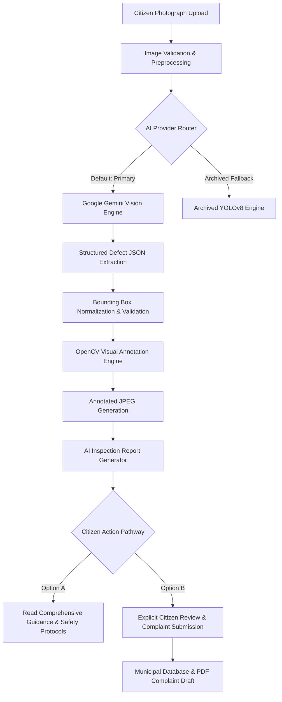

# VisionGuard AI 2.0
### Gemini-Powered Multimodal Infrastructure Defect Detection Platform

[](https://visionguard-ttyp.onrender.com/)
[](https://aistudio.google.com/)
[](https://pypi.org/project/google-genai/)
[-brightgreen.svg)]()
[]()

> **VisionGuard AI is a Gemini-powered multimodal infrastructure defect inspection platform that analyses road and building photographs, identifies visible damage, generates visual annotations and produces actionable inspection reports.**

---

## 1. Executive Overview & Architecture

VisionGuard AI 2.0 upgrades infrastructure condition surveys by pairing **Google's state-of-the-art Gemini Multimodal Vision models** with a dedicated **OpenCV Visual Annotation Engine** and an interactive citizen inspection portal. 

Citizens and municipal inspectors can upload or capture a photo of a roadway or building surface, receive localized bounding boxes, defect IDs, and preliminary severity assessments, explore safety guidance, and explicitly submit verified civic complaint drafts.



### Actual AI Architecture & Provider
- **Model Provider:** Google AI Studio / Google Gemini API
- **Official SDK:** `google-genai` (v2.20+)
- **Default Active Model:** `gemini-2.5-flash` (configurable via `GEMINI_MODEL`, fallback to `gemini-1.5-flash`)
- **Visual Annotation:** Custom OpenCV (`cv2`) annotation service rendering high-contrast bounding boxes, defect IDs (`[D001]`), defect types, and severity badges
- **Archived Fallback:** Historical YOLO checkpoints (`ai/models/best.pt`, `ai/models/home_best.pt`) remain safely archived and isolated for offline benchmarking without loading into production memory.

---

## 2. Key Capabilities & Features

### A. Road & Highway Defect Inspection
Identifies visible pavement distresses:
- **Potholes & Cavities** (Depth voids exposing base course)
- **Longitudinal Cracks** (Linear centerline joint separations)
- **Transverse Cracks** (Perpendicular thermal / structural fractures)
- **Alligator Fatigue Cracking** (Interconnected load fatigue patterns)
- **Surface Deterioration & Raveling** (Aggregate stripping and roughness)

### B. Building & Structural Defect Inspection
Identifies visible property and structural defects:
- **Wall Cracks** (Tensile and shearing fractures in masonry/drywall)
- **Dampness & Water Infiltration** (Moisture seepage and salt efflorescence)
- **Peeling & Blistered Paint** (Adhesion failure and weathering)
- **Plaster Spalling & Detachment** (Surface layer degradation)
- **Surface Spalling** (Exposed concrete aggregate and delamination)

### C. Visual Annotation Engine (OpenCV)
- Normalized coordinates $[0.0, 1.0]$ converted into precise pixel boundaries.
- Distinct color-coded severity palettes:
  - **Critical:** Crimson Red (`#EF4444`)
  - **High:** Vibrant Orange (`#F97316`)
  - **Moderate:** Vibrant Amber (`#F59E0B`)
  - **Low:** Electric Blue (`#3B82F6`)
  - **Uncertain:** Slate Gray (`#64748B`)
- High-contrast background banner pills to ensure labels remain readable against asphalt textures and weathered walls.
- Dynamic anti-collision offset to prevent overlapping banner text.
- Original uploaded photos are **never overwritten**; annotated images are generated as separate assets.

### D. AI Inspection Report
Every inspection generates a structured report:
1. Unique Inspection Reference ID (e.g., `#VG-104`)
2. Selected Domain (Road / Civil vs Building / Property)
3. Total Candidate Defects Count
4. Overall Preliminary Severity Rating
5. Visual Evidence Summary
6. Defect-by-Defect Breakdown:
   - What was observed?
   - Why might it be a problem?
   - Recommended maintenance action
   - Maintenance urgency priority
   - Safety guidance for citizens and pedestrians
   - On-site inspection checklist for municipal crews
7. Human Verification Notice: Explicitly disclaims that visual assessment is not a certified structural engineering calculation.

### E. Two Clear Citizen Action Pathways
- **OPTION A — READ GUIDANCE:** Expands full inspection guidance, why defects are hazardous, and on-site inspection points without filing a complaint.
- **OPTION B — SUBMIT OFFICIAL COMPLAINT:** Prompts the citizen with an explicit confirmation dialog displaying the defect summary, location, coordinates, and notes. Upon explicit user confirmation, persists the record, links the complaint draft, and generates instant downloadable PDF and plaintext notices.

---

## 3. Performance & Free-Tier Optimization (Render Free Cap: 512MB RAM)

Running deep learning frameworks like PyTorch or Ultralytics on cloud free-tier hosting (e.g. Render Free) often consumes 400MB–480MB of RAM just importing weights, leading to out-of-memory SIGKILL termination.

VisionGuard AI 2.0 solves this through **Lean Multimodal Architecture**:
- **PyTorch Bypassed in Default Path:** When `AI_PROVIDER=gemini` (default), PyTorch and Ultralytics are **never loaded into process memory**.
- **Memory Footprint:** Application boots with only **~90MB RSS**, leaving **>400MB of free headroom** on Render's 512MB RAM cap.
- **Resolution Safety Clamping:** Images larger than 1280px are safely scaled down with OpenCV before API transmission, cutting network payload size by 80% while retaining sharp defect clarity.
- **Quota & Timeout Handling:** Handles Google AI Studio free-tier rate limits (HTTP 429) gracefully with clear user guidance.

---

## 4. Technology Stack

| Layer | Technology | Purpose |
|---|---|---|
| **AI Vision Engine** | **Google Gemini Multimodal API** (`gemini-2.5-flash`) | Core visual understanding, multiple defect identification, severity triage |
| **Gen AI SDK** | **Official `google-genai` (v2.20+)** | High-performance Python SDK with structured JSON mode |
| **Annotation Engine** | **OpenCV (`cv2`)** | Non-destructive image overlay, bounding boxes, anti-collision text |
| **Web Backend** | **Python 3 / Flask 3.1** | Application factory, REST API, CSRF tokens, role-based auth |
| **WSGI Server** | **Gunicorn / Waitress** | Production HTTP application server |
| **Databases** | **SQLite (Local) / Neon PostgreSQL (Cloud)** | Relational storage for inspections, complaint drafts, user credentials |
| **Object Storage** | **Local Disk / Cloudflare R2** | Zero-egress persistent media storage for original and annotated imagery |
| **Reporting** | **ReportLab 4.x** | Automated PDF generation for civic complaint notices and audit sheets |
| **Frontend** | **HTML5 / Tailwind CSS / Vanilla ES6+ JS** | Dual-view image gallery, 5-step progress stepper, accessible modals |

---

## 5. Environment Variables & Setup Guide

Configure your backend by copying `.env.example` to `.env`:

```bash
cp .env.example .env
```

### Essential Settings in `.env`:

```env
# AI Provider: 'gemini' (default) or 'yolo' (archived fallback)
AI_PROVIDER=gemini

# Google AI Studio Gemini API Key (Required for active inspection)
GEMINI_API_KEY=your_actual_gemini_api_key_here

# Configurable Gemini Model
GEMINI_MODEL=gemini-2.5-flash

# Security Secret Key (Generate with: python -c "import secrets; print(secrets.token_hex(32))")
VISIONGUARD_SECRET_KEY=your_random_64_character_secret_key_here

# Persistent Database & Storage
VISIONGUARD_DB_PATH=data/visionguard.db
STORAGE_BACKEND=local
```

### Where to get your API key:
1. Visit [Google AI Studio](https://aistudio.google.com/).
2. Click **Get API key** and create a key in your Google Cloud / AI Studio project.
3. Paste the key into your `.env` file as `GEMINI_API_KEY=...` or in the Render Dashboard under **Environment Variables**.
4. **Security Notice:** Never commit `.env` or paste your secret key in public chat channels. The backend validates and guards this key securely.

---

## 6. Local Installation & Quickstart

### Prerequisites
- Python 3.10 to 3.14
- Virtual environment tool (`venv`)

### Installation Steps

```bash
# 1. Clone repository
git clone https://github.com/szeeshanZ123/visionGuard.git
cd visionGuard

# 2. Create and activate virtual environment
python -m venv venv
# On Windows:
.\venv\Scripts\activate
# On Linux/macOS:
source venv/bin/activate

# 3. Install dependencies
pip install -r requirements.txt

# 4. Configure environment
copy .env.example .env
# Edit .env and insert your GEMINI_API_KEY

# 5. Start development server
python wsgi.py
```

The server will start at `http://127.0.0.1:5000`.

---

## 7. Verification & Automated Test Results

The platform is validated with **81 passing automated tests** spanning security, multimodal analysis, OpenCV annotation, and civil complaint workflows:

```bash
python -m pytest tests/ -v
```

### Test Coverage Highlights:
- **`tests/test_gemini_multimodal_platform.py` (17 tests - 100% PASS):**
  - Road defect detection with multiple bounding boxes
  - Building defect detection (wall cracks, dampness)
  - Multiple defect itemization
  - Clean road surface handling (zero false positives)
  - Unclear and blurry image handling
  - Invalid / corrupt image rejection
  - Invalid bounding box coordinate normalization & clamping
  - Gemini API timeout handling
  - Free-tier quota exhaustion handling (HTTP 429)
  - Missing API key detection and setup guidance
  - Non-destructive OpenCV annotation rendering
  - Inspection persistence in SQLite
  - Historical report access
  - Authentication gates
  - Option B complaint workflow & PDF generation
  - Duplicate complaint prevention
  - Citizen access control & data isolation
- **Core Regression Suites (64 tests - 100% PASS):**
  - `tests/test_inference_timeout_and_errors.py`
  - `tests/test_api.py`
  - `tests/test_citizen_defect_reporting_ux.py`
  - `tests/test_frontend_integration.py`
  - `tests/test_citizen_csrf_security_routing.py`

---

## 8. Two-Minute Judge Demonstration Script

When presenting VisionGuard AI 2.0 to evaluators or judges, follow this concise workflow:

1. **Open Application:** Navigate to the live deployment or `http://127.0.0.1:5000`. Show the clean, modern landing page highlighting *VisionGuard Multimodal AI — Powered by Google Gemini Vision*.
2. **Citizen Authentication:** Click **Sign In**, log in with citizen credentials (or register a new account). Point out the active session badge and CSRF protection.
3. **Open Inspection Studio (`/create_home`):** Select **Road & Civil Infrastructure** (or **Building & Structural**).
4. **Upload Test Photo:** Drag & drop a road image with multiple defects (e.g. `data/evaluation_benchmark/images/benchmark_08_d20_alligator_urban.jpg`).
5. **Run Gemini Detection:** Click **Detect Defect**. Highlight the real 5-step progress stepper:
   - *Uploading photograph* $\to$ *Analysing with Gemini Vision* $\to$ *Identifying defects & severity* $\to$ *Rendering OpenCV overlay* $\to$ *Compiling AI report*.
6. **Show Visual Results:**
   - Toggle between **Annotated Overlay** and **Original Photo** to show exact bounding box localization.
   - Click **Zoom View** to inspect the high-resolution overlay modal.
7. **Review AI Inspection Report:**
   - Point out the **Severity Badge** (`Critical` or `High`), the **Executive Summary**, and the individual **Defect Cards** showing unique IDs (`[D001]`), visual evidence, and recommended repair actions.
8. **Demonstrate Option A (Read Guidance):** Click **Read Full Guidance & Safety Steps** to expand the civil safety guidelines and on-site inspection checklist without filing a complaint.
9. **Demonstrate Option B (Submit Complaint):** Click **Review & Confirm Complaint Submission**. Show the citizen verification modal with pre-filled coordinates, address, and legal confirmation. Click **Confirm & Submit Complaint Draft**.
10. **Download Official Grievance:** Click **Download PDF** to show the generated official municipal complaint document, and click **My Reports** to show the inspection persisted in the citizen dashboard.

---

## 9. Checkpoint Asset Protection

VisionGuard AI 2.0 strictly preserves all existing experimental models in an isolated, read-only state:
- `ai/models/best.pt`: SHA-256 `01c27f61ee370392a8fa1b66f1c0a22fca4e93b3d0615ef7b932f91da6818f14`
- `ai/models/home_best.pt`: SHA-256 `71c64ac75204d6d791bc107df7f7afa6115a2da9bfa3491881e8d3e753a1ed70`

These checkpoints remain untouched for historical research and offline ablation comparisons. Active citizen detection runs entirely on Google Gemini Vision.

---

## 10. License & Legal Disclaimer

Preliminary visual defect assessments generated by VisionGuard AI 2.0 are provided for informational and municipal assistance purposes only. They do not constitute a certified professional structural engineering survey, legal warranty, or municipal repair guarantee.
