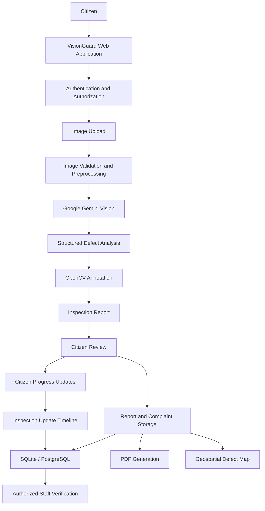
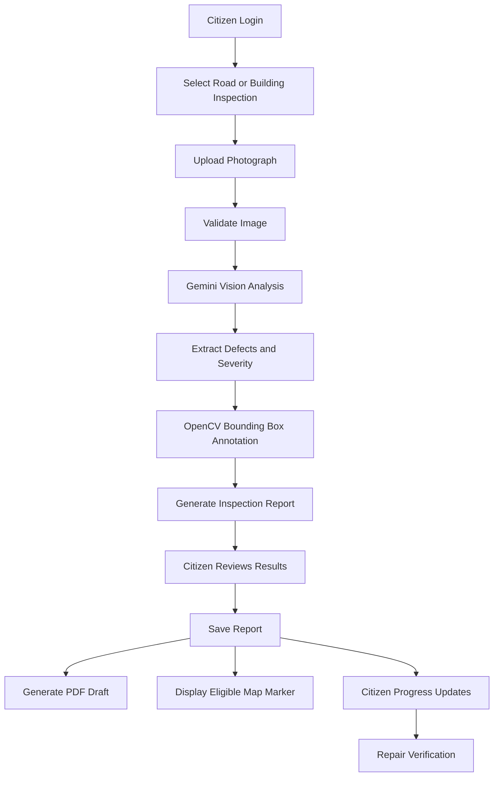

# VisionGuard AI 2.0
### AI-Powered Multimodal Infrastructure Defect Detection, Inspection & Citizen Reporting Platform

<p align="center">
  <strong>Making infrastructure monitoring smarter through Artificial Intelligence, Computer Vision and Citizen Participation.</strong>
</p>

<p align="center">
  <a href="https://visionguard-ttyp.onrender.com/">
    
  </a>
  
  
  
  
</p>

---

## 1. Project Description

**VisionGuard AI 2.0** is an AI-powered multimodal infrastructure inspection and citizen reporting platform designed to identify, document, visualize and track visible infrastructure defects in roads, highways and buildings.

The platform uses Google's Gemini Multimodal Vision model to analyse uploaded photographs, identify multiple visible defects, classify their categories, estimate preliminary severity and generate structured inspection reports.

VisionGuard combines Artificial Intelligence, image processing, geospatial visualization and citizen participation into one integrated platform.

Citizens can upload photographs of damaged roads or buildings, receive AI-generated inspection results, view annotated defect images, generate PDF reports, submit civic complaint drafts and track the progress of previously reported issues.

A key feature is the **Citizen Report Update System**, which allows users to update an existing report when repair work begins, when an issue remains unresolved, when conditions worsen or when a road appears to have been repaired.

This creates a continuous reporting and monitoring cycle rather than treating each inspection as an isolated event.

**Live Application:** https://visionguard-ttyp.onrender.com/

**GitHub Repository:** https://github.com/szeeshanZ123/visionGuard

---

## 2. Problem Statement

Urban infrastructure is continuously exposed to environmental conditions, heavy traffic, water infiltration, material deterioration and structural stress.

These conditions lead to common infrastructure problems, including:

- Potholes and damaged road surfaces.
- Longitudinal and transverse road cracks.
- Alligator cracking and pavement deterioration.
- Wall cracks and surface fractures.
- Dampness and water infiltration.
- Peeling paint and plaster damage.
- Concrete spalling and surface deterioration.

Traditional infrastructure inspection often depends on manual observation and reporting. This creates several challenges:

1. **Time-consuming inspections:** Identifying and documenting defects manually can require significant time and human effort.
2. **Delayed reporting:** Citizens may notice damaged infrastructure but lack a simple and accessible reporting mechanism.
3. **Limited visual documentation:** Reports may not contain standardized photographs, defect classifications or supporting evidence.
4. **Lack of centralized tracking:** Citizens may find it difficult to know whether a reported issue is being addressed.
5. **Poor progress visibility:** A reported pothole may eventually be repaired, but the original report may not reflect the real-world progress.
6. **Limited geospatial awareness:** Infrastructure defects need to be associated with geographical locations to support monitoring and prioritization.

There is a need for an accessible, intelligent and transparent system that connects infrastructure defect detection with citizen reporting, location-based visualization and progress tracking.

---

## 3. Proposed Solution

VisionGuard AI proposes an integrated, AI-powered infrastructure monitoring and citizen reporting platform.

The system allows citizens to upload photographs of infrastructure defects and uses Google Gemini Vision to analyse the images and generate structured inspection results.

The proposed solution consists of the following components:

### 3.1 AI-Powered Defect Detection

Use Google's Gemini Multimodal Vision model to analyse road and building photographs.

The system identifies visible infrastructure defects, categorizes them and generates preliminary severity assessments.

### 3.2 Automated Image Annotation

Use OpenCV to draw bounding boxes around detected defects.

Each detected defect can receive an individual identification label, such as D001 or D002, along with a visual severity indicator.

### 3.3 Structured Inspection Reports

Generate detailed reports containing:

- Inspection reference ID.
- Defect category.
- Number of detected defects.
- Preliminary severity.
- Visual evidence.
- AI-generated observations.
- Suggested maintenance actions.
- Safety recommendations.

### 3.4 Citizen Reporting and Complaint Assistance

Allow citizens to review AI-generated findings and prepare civic complaint reports.

The platform supports report storage and PDF draft generation for documentation and further submission through appropriate channels.

### 3.5 Geospatial Defect Visualization

Use an interactive map to visualize eligible infrastructure defect reports using geographical coordinates.

This provides a location-based view of reported infrastructure problems.

### 3.6 Citizen Report Progress Tracking

Allow citizens to revisit previously submitted reports and communicate changes in the real-world condition of an issue.

Supported updates include:

- Work Started.
- Road Repaired.
- Issue Still Exists.
- Issue Has Become Worse.

Citizens can add comments and upload updated photographs.

Repair claims remain pending verification until an authorized inspector confirms the result.

**Overall proposed solution:** VisionGuard AI connects AI-powered infrastructure inspection with citizen participation, visual documentation, geospatial monitoring and repair progress reporting.

---

## 4. Project Objectives

The main objectives of VisionGuard AI are:

1. Automate the preliminary identification of visible infrastructure defects.
2. Reduce the effort required to document infrastructure problems.
3. Generate structured and visually supported inspection reports.
4. Improve accessibility of civic infrastructure reporting.
5. Provide geographical visualization of eligible reported defects.
6. Allow citizens to track the progress of their submitted reports.
7. Support transparent communication about repair progress.
8. Maintain historical inspection records and supporting evidence.
9. Provide a foundation for future smart-city infrastructure monitoring systems.

---

## 5. Key Features

### A. Road Infrastructure Inspection

VisionGuard can analyse photographs containing visible road defects such as:

| Defect | Description |
|---|---|
| Potholes | Cavities and damaged road surfaces |
| Longitudinal Cracks | Cracks running parallel to the road |
| Transverse Cracks | Cracks running across the road |
| Alligator Cracking | Interconnected fatigue cracks |
| Surface Deterioration | Visible pavement wear and material loss |
| Raveling | Loss of asphalt aggregate from the road surface |

### B. Building Infrastructure Inspection

The platform also supports visual analysis of building-related defects.

| Defect | Description |
|---|---|
| Wall Cracks | Visible fractures in walls and plaster |
| Dampness | Moisture-related surface damage |
| Water Infiltration | Visible signs of water seepage |
| Peeling Paint | Deterioration of painted surfaces |
| Plaster Damage | Cracking and deterioration of plaster |
| Surface Spalling | Visible loss or detachment of concrete or plaster |

### C. AI-Based Image Analysis

- Google Gemini Multimodal Vision integration.
- Multiple visible defect identification.
- Structured JSON output.
- Defect categorization.
- Preliminary severity classification.
- Image validation and preprocessing.
- Handling of unclear or inconclusive images.

### D. OpenCV Image Annotation

- Bounding box visualization.
- Individual defect identification labels.
- Color-coded severity indicators.
- Normalized coordinate validation.
- Original image preservation.
- Annotated image generation.

### E. Inspection Report Generation

Each inspection can include:

- Unique inspection reference.
- Original photograph.
- Annotated photograph.
- Defect identification.
- Preliminary severity assessment.
- AI-generated description.
- Recommended maintenance actions.
- Geographical information when available.

### F. PDF Report Generation

VisionGuard uses ReportLab to generate downloadable PDF documentation containing relevant inspection and complaint information.

These documents support record keeping and preparation of civic complaints.

### G. Interactive Geospatial Defect Map

The map provides geographical visualization of eligible reported defects.

Features include:

- Interactive Leaflet.js map.
- Location-based defect markers.
- Defect category filters.
- Inspection location information.
- Marker details.
- Map synchronization and data refresh.

Only appropriate public-safe records should be exposed on the public map.

### H. Citizen Report Update System

A major feature of VisionGuard AI is the ability to update previously submitted reports.

A citizen can:

1. Open an existing inspection report.
2. Select the current condition.
3. Add an optional comment.
4. Upload updated photographic evidence.
5. Submit the progress update.
6. View the chronological report timeline.

Supported update types:

| Update | Meaning |
|---|---|
| Work Started | Citizen reports that repair activity has begun |
| Road Repaired | Citizen reports that the defect appears repaired |
| Issue Still Exists | Citizen reports that the problem remains |
| Issue Has Become Worse | Citizen reports further deterioration |

Citizen-reported updates are separate from official inspection verification.

For example, selecting Road Repaired does not automatically mark an inspection as officially resolved. An authorized inspector must verify the repair.

### I. Authentication and Access Control

The platform includes:

- Citizen registration and login.
- Password-based authentication.
- Google OAuth integration.
- Session-based authentication.
- Role-based access control.
- CSRF protection.
- Report ownership validation.
- Protected inspection and update endpoints.

### J. Historical Inspection Records

Users can revisit their previously submitted inspection reports, view inspection details and review associated progress updates.

---

## 6. System Architecture

VisionGuard follows a modular architecture connecting the frontend, Flask backend, AI analysis engine, image processing layer, database and storage system.

### High-Level Architecture



### Inspection Workflow



---

## 7. Technology Stack

| Component | Technology | Purpose |
|---|---|---|
| Programming Language | Python | Backend and AI integration |
| Web Framework | Flask 3.1 | Application backend and REST APIs |
| AI Engine | Google Gemini Vision | Multimodal defect analysis |
| AI SDK | Google Gen AI SDK | Gemini API integration |
| Active Model Configuration | `gemini-3.1-flash-lite` | Image understanding and analysis |
| Image Processing | OpenCV | Bounding boxes and annotations |
| Data Processing | NumPy | Numerical and image operations |
| Frontend | HTML5 | Web page structure |
| Styling | Tailwind CSS | Responsive user interface |
| JavaScript | Vanilla JavaScript | Frontend interactions |
| Maps | Leaflet.js | Geospatial visualization |
| Database | SQLite / PostgreSQL | Users and inspection records |
| Cloud Database | Neon PostgreSQL | Hosted relational persistence |
| Object Storage | Local Storage / Cloudflare R2 | Inspection image storage |
| PDF Generation | ReportLab | PDF documentation |
| Authentication | Flask Sessions / Google OAuth | User authentication |
| Testing | Pytest | Automated testing |
| Deployment | Render | Web application hosting |

---

## 8. AI Detection and Image Processing

### Google Gemini Vision

VisionGuard uses Google's Gemini multimodal model as its primary active image-analysis engine.

The AI analyses uploaded photographs and returns structured defect information.

The configured model is:

```env
AI_PROVIDER=gemini
GEMINI_MODEL=gemini-3.1-flash-lite
```

The backend uses the official Google Gen AI Python SDK.

### OpenCV Annotation

After receiving the structured defect information, the image-processing layer converts normalized bounding box coordinates into image pixel coordinates.

The annotation engine validates coordinate boundaries before drawing the overlays.

Example:

```python
x1 = int(normalized_x1 * image_width)
y1 = int(normalized_y1 * image_height)

x2 = int(normalized_x2 * image_width)
y2 = int(normalized_y2 * image_height)
```

The resulting image displays defect bounding boxes and identification labels.

The original photograph remains unchanged.

### Severity Classification

The platform supports preliminary visual severity categories:

- Critical
- High
- Moderate
- Low
- Uncertain / Inconclusive

These classifications are AI-generated screening assessments and are not certified engineering conclusions.

### Model Management

Historical YOLOv8 model checkpoints are preserved for offline comparative research and future edge-model development.

The archived model weights are not the active production inference engine according to the documented production architecture.

---

## 9. Database and Data Management

VisionGuard supports SQLite for local development and PostgreSQL for hosted deployment.

The database stores information required for authentication, inspections, reporting and progress tracking.

Major data entities include:

- Users.
- Inspection records.
- Defect information.
- Complaint information.
- Citizen inspection updates.
- Maintenance activity records.

### Citizen Inspection Updates

The `inspection_updates` data model stores progress information associated with existing inspection records.

Its fields include:

| Field | Purpose |
|---|---|
| id | Unique update identifier |
| inspection_id | Associated inspection |
| user_id | User submitting the update |
| username | Associated username, where stored |
| update_type | Reported progress condition |
| comment | Optional citizen description |
| image_path | Optional supporting photograph |
| verification_status | Verification state |
| created_at | Update timestamp |

The update history is associated with the original inspection rather than creating a new inspection for every progress update.

---

## 10. Security and Privacy

VisionGuard implements application-level protections to safeguard user information and inspection records.

Security considerations include:

- Password-based authentication.
- Google OAuth authentication.
- Session management.
- Role-based route protection.
- CSRF validation.
- Inspection ownership verification.
- Secure image upload validation.
- Safe filename handling.
- Protected image retrieval.
- Restricted access to private inspection records.
- Public-map data sanitization.

Citizen repair claims do not directly overwrite official inspection statuses.

Private comments, user identities and private inspection photographs must not be exposed through public map endpoints.

API keys and security secrets must be stored in environment variables rather than frontend code or source control.

---

## 11. Installation and Local Setup

### Prerequisites

- Python 3.10 or later.
- Git.
- Internet connection.
- Google Gemini API key.
- A code editor such as VS Code.

### Step 1: Clone the Repository

```bash
git clone https://github.com/szeeshanZ123/visionGuard.git

cd visionGuard
```

### Step 2: Create a Virtual Environment

```bash
python -m venv venv
```

Windows:

```powershell
.\venv\Scripts\activate
```

Linux / macOS:

```bash
source venv/bin/activate
```

### Step 3: Install Dependencies

```bash
pip install -r requirements.txt
```

### Step 4: Configure Environment Variables

Create a `.env` file in the project root.

```env
AI_PROVIDER=gemini

GEMINI_API_KEY=your_gemini_api_key
GEMINI_MODEL=gemini-3.1-flash-lite

VISIONGUARD_SECRET_KEY=your_secure_random_secret

VISIONGUARD_DB_PATH=data/visionguard.db

STORAGE_BACKEND=local
```

Configure additional database, OAuth and object-storage variables according to `.env.example` and the deployment environment.

**Never commit `.env` or expose API keys in public repositories.**

### Step 5: Start the Application

```bash
python wsgi.py
```

Open:

```text
http://127.0.0.1:5000
```

---

## 12. Environment Configuration

Important configuration variables include:

| Variable | Description |
|---|---|
| `AI_PROVIDER` | Selects the AI provider |
| `GEMINI_API_KEY` | Google Gemini API key |
| `GEMINI_MODEL` | Configured Gemini model |
| `VISIONGUARD_SECRET_KEY` | Flask session security key |
| `VISIONGUARD_DB_PATH` | Local SQLite database path |
| `DATABASE_URL` | PostgreSQL connection string when configured |
| `STORAGE_BACKEND` | Storage provider selection |
| `GOOGLE_CLIENT_ID` | Google OAuth client identifier |
| `GOOGLE_CLIENT_SECRET` | Google OAuth client secret |
| `GOOGLE_REDIRECT_URI` | OAuth callback URL |

Actual production configuration should be managed securely through the hosting provider's environment settings.

---

## 13. Testing and Quality Assurance

VisionGuard includes automated tests covering its application, authentication, database operations, AI inspection workflow and reporting features.

Run the test suite using:

```bash
python -m pytest tests/ -v
```

Important testing areas include:

- Gemini image analysis.
- Road defect detection.
- Building defect detection.
- Multiple defect identification.
- Bounding box validation.
- OpenCV annotation.
- Invalid image handling.
- Database persistence.
- Citizen authentication.
- Role-based access control.
- CSRF protection.
- Inspection ownership.
- PDF report generation.
- Public map data.
- Citizen progress updates.
- Repair verification integrity.
- Image upload and retrieval.

The latest feature-specific citizen update regression report recorded 42 passing tests across update, authentication, privacy and report-access checks. Full-suite results should be verified against the current repository before publishing a test-count badge.

---

## 14. Deployment

VisionGuard AI is hosted on Render.

**Production Application:**

https://visionguard-ttyp.onrender.com/

Deployment configuration requires:

- Python dependencies.
- WSGI application startup.
- Gemini API credentials.
- Secure Flask secret key.
- Persistent database configuration.
- Appropriate image storage configuration.
- Google OAuth configuration when enabled.
- Correct production callback URLs.

For production use, database and image storage must be configured for persistence. Local filesystem storage on an ephemeral hosting instance should not be treated as durable storage.

---

## 15. Project Limitations

VisionGuard is designed for preliminary visual infrastructure assessment.

Its current limitations include:

1. **Visual Analysis Only:** Photographs cannot reveal all subsurface structural defects.
2. **Image Quality Dependency:** Poor lighting, low resolution and blur may affect detection accuracy.
3. **No Physical Measurement Guarantee:** Bounding boxes do not establish actual crack width, depth or structural capacity.
4. **Preliminary Severity:** AI-generated severity does not replace a professional engineering assessment.
5. **Location Dependency:** Accurate geospatial mapping requires valid location information.
6. **Internet Dependency:** Gemini-based inference requires connectivity to the configured API.
7. **Verification Requirement:** Citizen-reported repair progress requires appropriate verification before being treated as an official resolution.
8. **Municipal Integration:** Generating a complaint PDF does not itself submit an official complaint to a municipal authority.

---

## 16. Future Scope

Potential future improvements include:

- Custom YOLOv8 edge-model inference.
- Offline infrastructure defect detection.
- Drone-based infrastructure inspection.
- Automated road condition monitoring.
- Advanced infrastructure deterioration analytics.
- Municipal complaint portal integration.
- Open311-compatible integrations.
- Geographic hotspot analysis.
- Predictive infrastructure maintenance.
- Time-series defect progression analysis.
- Mobile application improvements.
- Municipal authority integration.

---

## 17. Expected Impact

VisionGuard AI aims to contribute to smarter infrastructure monitoring through:

- Faster preliminary defect identification.
- Better visual documentation.
- More accessible citizen reporting.
- Improved geographical awareness of infrastructure problems.
- Historical tracking of reported defects.
- Better visibility into repair progress.
- A structured information flow between citizens and inspection teams.

The platform provides a foundation for a more transparent and data-driven infrastructure reporting process.

---

## 18. Project Disclaimer

VisionGuard AI provides AI-generated preliminary visual assessments for informational, educational and civic assistance purposes.

Its outputs are not certified structural engineering surveys, safety certifications, legal warranties or guarantees of municipal repair.

All significant structural and safety decisions must be reviewed by appropriately qualified professionals.

Citizen-submitted repair updates represent reported observations and do not constitute official verification.

---

## 19. Project Links

| Resource | Link |
|---|---|
| Live Application | https://visionguard-ttyp.onrender.com/ |
| GitHub Repository | https://github.com/szeeshanZ123/visionGuard |
| Google AI Studio | https://aistudio.google.com/ |
| Google Gemini Documentation | https://ai.google.dev/gemini-api/docs |
| Flask Documentation | https://flask.palletsprojects.com/ |
| OpenCV Documentation | https://docs.opencv.org/ |
| Leaflet Documentation | https://leafletjs.com/ |

---

<p align="center">
  <strong>VisionGuard AI 2.0</strong>
  <br>
  AI-Powered Infrastructure Inspection and Citizen Reporting
  <br><br>
  <em>Detect. Document. Report. Monitor.</em>
</p>
