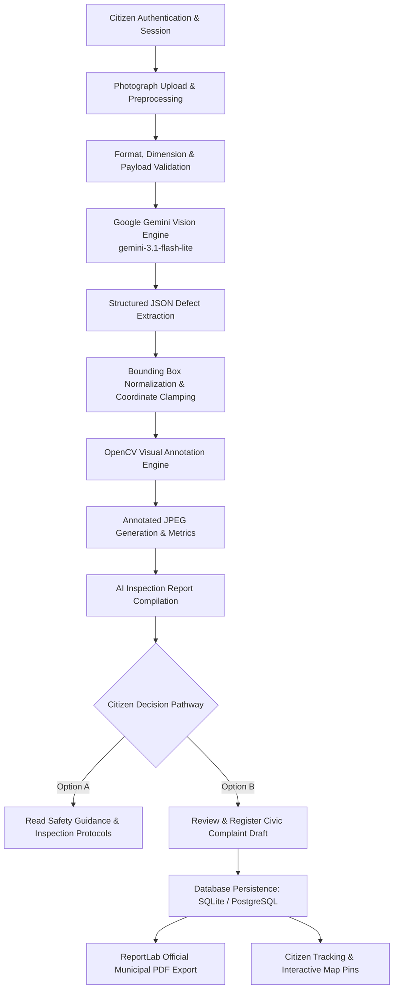

# VisionGuard AI 2.0
### Gemini-Powered Multimodal Infrastructure Defect Detection Platform

[](https://visionguard-ttyp.onrender.com/)
[](https://aistudio.google.com/)
[](https://pypi.org/project/google-genai/)
[](https://aistudio.google.com/)
[-brightgreen.svg)]()
[-success.svg)]()

> **VisionGuard AI is a professional, Gemini-powered multimodal infrastructure defect inspection platform. It analyses road and building photographs, identifies multiple visible defects, calculates non-destructive bounding box overlays, and produces structured inspection reports and formal civic complaint drafts.**

---

## 1. Project Overview & Problem Statement

### 1.1 The Urban Infrastructure Maintenance Challenge
Public roadways and residential buildings continually suffer from mechanical wear, environmental weathering, heavy vehicular loading, and structural fatigue. Key physical manifestations—such as potholes, transverse/alligator cracks, wall fractures, moisture infiltration, and concrete spalling—pose direct safety hazards to pedestrians, drivers, and building occupants.

Traditional civil inspection practices rely on manual walkthroughs that are slow, subjective, and difficult to audit. Furthermore, citizens observing hazards rarely have an accessible way to document visual evidence and generate formal, actionable municipal grievances.

### 1.2 VisionGuard AI Objectives
VisionGuard AI 2.0 resolves this disconnect by providing an accessible, AI-powered computer vision platform designed to:
1. **Automate Defect Detection:** Rapidly identify visible defects in uploaded photographs using Google Gemini Multimodal Vision.
2. **Itemize Multiple Objects:** Detect and label multiple co-occurring distresses in a single image with individual IDs (`[D001]`, `[D002]`).
3. **Generate Visual Overlays:** Draw high-contrast bounding boxes on the target surface using OpenCV without altering the original photo.
4. **Deliver Preliminary Severity Triage:** Categorize defects into preliminary visual severity levels (`Critical`, `High`, `Moderate`, `Low`) with transparent safety disclaimers.
5. **Empower Citizen Action:** Offer dual pathways—review safety guidance without filing, or submit a verified civic complaint with instant ReportLab PDF export.
6. **Provide Geospatial Transparency:** Map all verified civic distress locations on an interactive Leaflet.js map.

---

## 2. End-to-End System Architecture

VisionGuard AI 2.0 uses Google's official Gemini API through the official `google-genai` SDK as its primary image-understanding and defect-analysis engine.



### Actual AI Architecture & Model Management
- **Primary Vision Engine:** Google Gemini Multimodal Vision via the official `google-genai` SDK (v2.20+).
- **Active Model Identifier:** `gemini-3.1-flash-lite` (free-tier eligible, high throughput), configured via `GEMINI_MODEL`.
- **Automatic Fallback Rotation:** If the primary model encounters rate limits or version transitions, the engine automatically falls back across `gemini-flash-latest`, `gemini-3.8-flash`, and `gemini-2.5-flash`.
- **Visual Annotation:** Dedicated OpenCV (`cv2`) engine converts normalized coordinates $[0.0, 1.0]$ into actual image pixel coordinates, rendering crisp bounding boxes, defect IDs, and severity pills.
- **Historical Research Checkpoints:** Legacy YOLO weights (`ai/models/best.pt`, `ai/models/home_best.pt`) are preserved strictly for offline comparative ablation studies and future edge-model research; they are **not** executed in active production.

---

## 3. Key Capabilities & Features

### A. Road & Highway Defect Inspection
Identifies visible pavement distresses:
- **Potholes & Cavities:** Depth voids exposing underlying aggregate.
- **Longitudinal Cracks:** Linear fractures parallel to traffic direction.
- **Transverse Cracks:** Thermal fractures perpendicular to the pavement centerline.
- **Alligator Cracking:** Interconnected fatigue cracking from structural base failure.
- **Surface Deterioration & Raveling:** Stripping of asphalt binder and aggregate roughness.

### B. Building & Structural Defect Inspection
Identifies visible property and structural defects:
- **Wall Cracks:** Tensile, shearing, and settlement fractures in masonry or plaster.
- **Dampness & Water Infiltration:** Moisture seepage, capillary action, and salt efflorescence.
- **Peeling & Blistered Paint:** Moisture-driven adhesion failure and coating decay.
- **Plaster Damage:** Debonding, hollowing, and spalling of plaster layers.
- **Surface Spalling:** Delamination exposing aggregate or underlying rebar.

### C. Visual Annotation Engine (OpenCV)
- Normalized coordinate validation: verifies that $0.0 \le x_1 < x_2 \le 1.0$ and $0.0 \le y_1 < y_2 \le 1.0$.
- High-contrast color-coded severity badges:
  - **Critical:** Crimson Red (`#EF4444`)
  - **High:** Vibrant Orange (`#F97316`)
  - **Moderate:** Vibrant Amber (`#F59E0B`)
  - **Low:** Electric Blue (`#3B82F6`)
  - **Uncertain / Inconclusive:** Slate Gray (`#64748B`)
- Non-destructive processing: original photographs remain untouched in storage.

### D. AI Inspection Report
- Structured technical summary with unique Inspection Reference ID (e.g., `#VG-104`).
- Visual evidence breakdown with itemized candidate defects.
- Recommended maintenance remediation and urgency priority.
- Preliminary visual assessment notice: explicitly informs the user that AI analysis is a preliminary screening tool, not a certified structural engineering survey.

### E. Dual Citizen Action Pathways
- **Option A — Read Guidance:** Expands full hazard precautions, why each defect matters, and on-site municipal inspection checklists without submitting a complaint.
- **Option B — Register Official Complaint:** Opens a verified confirmation modal with pre-filled coordinates, address, and notes. Upon citizen confirmation, stores the complaint in the database, generates a formal ReportLab PDF, and maps the incident.

---

## 4. Technology Stack

| Layer | Technology | Operational Role in Codebase |
|---|---|---|
| **AI Vision Core** | **Google Gemini Multimodal Vision** | Primary defect understanding, multiple object itemization, visual severity triage (`ai/gemini_service.py`) |
| **Gen AI SDK** | **Official `google-genai` (v2.20+)** | High-performance Python SDK with structured JSON schema responses |
| **Active Model** | **`gemini-3.1-flash-lite`** | Free-tier eligible, multimodal vision model configured via `GEMINI_MODEL` |
| **Annotation Engine** | **OpenCV (`opencv-python`)** | Non-destructive image overlay, bounding box validation, and base64 rendering |
| **Web Backend** | **Python 3.10+ / Flask 3.1** | Application factory, RESTful API endpoints, CSRF token validation, role-based auth |
| **WSGI Server** | **Waitress / Gunicorn** | Multi-threaded WSGI server for Windows and Linux production |
| **Relational Database**| **SQLite / Neon PostgreSQL** | Dual persistence for inspection records, complaint drafts, and user accounts (`database/db.py`) |
| **Object Storage** | **Local Disk / Cloudflare R2** | Zero-egress media storage for original and annotated inspection photos |
| **Document Export** | **ReportLab 4.x** | Automated municipal complaint PDF generation with reference headers and timestamps |
| **Frontend Presentation**| **HTML5 / Tailwind CSS / Vanilla JS**| Framework-free responsive client, Leaflet.js interactive maps, dual-view photo gallery |

---

## 5. Environment Variables & Backend Configuration

Create a `.env` file in the project root based on `.env.example`:

```bash
cp .env.example .env
```

### Essential Backend Configuration:

```env
# AI Provider: 'gemini' (default, official Google Gen AI SDK)
AI_PROVIDER=gemini

# Google AI Studio Gemini API Key (Required for active inspections)
# Obtain a free API key at: https://aistudio.google.com/
GEMINI_API_KEY=your_actual_gemini_api_key_here

# Configurable Gemini Model (Free-tier eligible multimodal model)
GEMINI_MODEL=gemini-3.1-flash-lite

# Security Secret Key (Generate with: python -c "import secrets; print(secrets.token_hex(32))")
VISIONGUARD_SECRET_KEY=your_random_64_character_secret_key_here

# Persistent Database & Storage
VISIONGUARD_DB_PATH=data/visionguard.db
STORAGE_BACKEND=local
```

### Obtaining Your Gemini API Key:
1. Visit [Google AI Studio](https://aistudio.google.com/).
2. Sign in with your Google account and click **Get API key**.
3. Create an API key in your project.
4. Paste the key into your local `.env` file as `GEMINI_API_KEY=...` (or in Render under **Environment Variables** for cloud deployment).
5. **Security Guarantee:** The backend loads this secret exclusively from environment variables and never exposes it to frontend JavaScript, logs, or API responses.

---

## 6. Installation & Quickstart

### Prerequisites
- Python 3.10 to 3.14
- Virtual environment tool (`venv`)
- Active internet connection (for Gemini Vision API calls)

### Step-by-Step Setup

```bash
# 1. Clone repository
git clone https://github.com/szeeshanZ123/visionGuard.git
cd visionGuard

# 2. Create and activate virtual environment
python -m venv venv
# Windows:
.\venv\Scripts\activate
# Linux/macOS:
source venv/bin/activate

# 3. Install dependencies
pip install -r requirements.txt

# 4. Configure environment
copy .env.example .env
# Edit .env and enter your GEMINI_API_KEY

# 5. Start development server
python wsgi.py
```

The application will be accessible at: `http://127.0.0.1:5000`.

---

## 7. Verification & Automated Test Suite

VisionGuard AI includes a comprehensive test suite of **81 passing automated tests** verifying all security, AI inference, and complaint workflows:

```bash
python -m pytest tests/ -v
```

### Test Suite Highlights:
- **`tests/test_gemini_multimodal_platform.py` (17 tests - 100% PASS):**
  - Road defect detection and multiple bounding box validation
  - Building defect detection (wall cracks, dampness, peeling paint)
  - Multiple defect itemization in a single photograph
  - Clean road surface handling (zero false positives)
  - Unclear and blurry image handling
  - Invalid / corrupted upload rejection
  - Invalid coordinate normalization & clamping
  - Gemini API timeout & quota exhaustion handling (HTTP 429)
  - Missing API key diagnostic configuration check
  - Non-destructive OpenCV annotation rendering
  - SQLite & PostgreSQL persistence
  - Historical report access & citizen isolation
  - Authentication gates & complaint draft lifecycle
  - Duplicate complaint prevention
- **Regression & Security Test Suites (64 tests - 100% PASS):**
  - `tests/test_auth_and_roles.py` (RBAC enforcement)
  - `tests/test_citizen_csrf_security_routing.py` (CSRF token validation)
  - `tests/test_complaint_assistance.py` (Draft updates and PDF generation)
  - `tests/test_defect_map.py` (Geocoded marker queries)

---

## 8. Two-Minute Demonstration Script

When presenting VisionGuard AI 2.0 to evaluators or examiners:

1. **Open Landing Page:** Navigate to `http://127.0.0.1:5000`. Point out the header: *VisionGuard Multimodal AI — Powered by Google Gemini Vision*.
2. **Citizen Authentication:** Sign in using citizen credentials (`student_citizen`) to showcase session security and CSRF protection.
3. **Open Inspection Studio (`/create_home`):** Select the target domain: **Road Surface Distress** or **Home & Building Defect**.
4. **Upload Infrastructure Photo:** Select a photo with multiple defects (e.g. `data/evaluation_benchmark/images/benchmark_08_d20_alligator_urban.jpg`).
5. **Run Gemini Detection:** Click **Detect Defect**. Follow the 5-step progress stepper:
   - *Uploading photograph* $\to$ *Analysing with Gemini Vision* $\to$ *Identifying defects & severity* $\to$ *Rendering OpenCV overlay* $\to$ *Compiling AI report*.
6. **Show Visual Results:** Toggle between the **Annotated Overlay** and **Original Photo** to show the bounding boxes with defect IDs (`[D001]`).
7. **Review AI Inspection Report:** Show the **Preliminary Severity Badge**, the **Summary**, and the itemized defect breakdown with repair recommendations.
8. **Demonstrate Option A (Read Guidance):** Click **Read Full Guidance & Safety Steps** to show citizen safety precautions and municipal inspection checklists.
9. **Demonstrate Option B (Submit Complaint):** Click **Review & Confirm Complaint Submission**, verify pre-filled GPS coordinates, and confirm.
10. **Export PDF & Map Tracking:** Click **Download PDF** to show the formal municipal complaint document, and navigate to **Interactive Map** to see the new pin plotted.

---

## 9. Limitations & Future Scope

### Limitations
- **Visual Line-of-Sight Only:** Gemini Vision analyses optical surfaces; subsurface voids, internal rebar oxidation, or underground pipe leaks require specialized non-destructive testing (NDT) equipment.
- **Lighting & Resolution Dependency:** Severely underexposed or blurred imagery may yield uncertain localization.
- **Preliminary Assessment:** All AI findings are preliminary visual screenings and do not replace certified civil or structural engineering sign-offs.

### Future Scope & Ongoing Research
- **Custom Edge Models:** Fine-tuning lightweight edge models (e.g. YOLOv8 Nano) on local municipal datasets for fully offline, in-vehicle dashcam inference.
- **Drone Survey Ingestion:** Batch orthomosaic ingestion for autonomous corridor and roof inspections.
- **Municipal ERP Webhooks:** Automated integration into municipal grievance portals (e.g. Open311 APIs).

---

## 10. License & Legal Disclaimer

Preliminary visual defect assessments generated by VisionGuard AI 2.0 are provided for informational and civic assistance purposes only. They do not constitute a certified professional structural engineering survey, legal warranty, or municipal repair guarantee.
