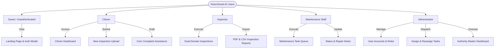
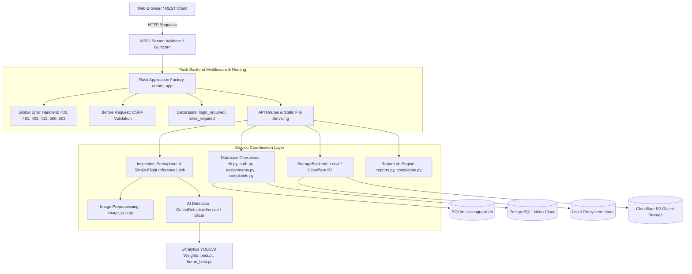
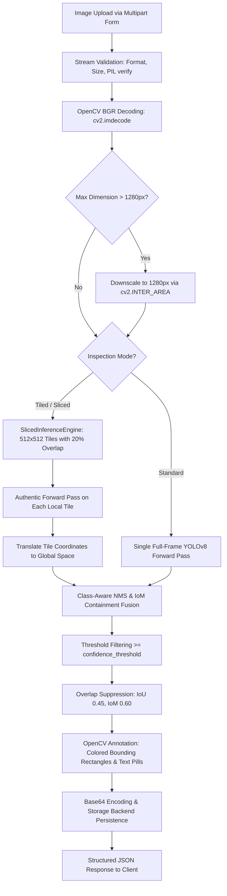
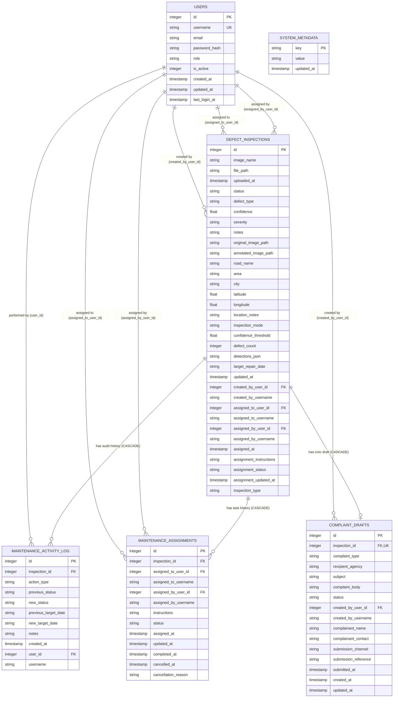
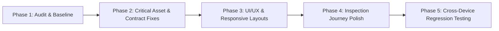

# VisionGuard AI 2.0 -- System Architecture & Technical Specification

> **Document Classification:** Comprehensive System Architecture & Engineering Baseline  
> **Document Name:** project_architecture.md  
> **Repository Location:** Project Root (/project_architecture.md)  
> **Platform Version:** VisionGuard AI 2.0 (Gemini-Powered Multimodal Platform)  
> **Primary Runtime:** Python 3.11+ / Python 3.14 (WSGI Gunicorn / Waitress, Flask 3.1+)  
> **AI Vision Core:** Google Gemini Multimodal Vision (gemini-2.5-flash, official google-genai SDK)  
> **Annotation Engine:** OpenCV (cv2) Visual Overlay Engine (Non-destructive)  
> **Frontend:** Responsive HTML5, Tailwind CSS, Vanilla ES6+ JavaScript, Leaflet.js  
> **Persistence & Storage:** Dual SQLite / Neon PostgreSQL & Local Disk / Cloudflare R2  

---

## 1. Project Overview

### 1.1 Project Name
**VisionGuard AI** (AI-Powered Infrastructure Defect Detection, Analysis, Inspection Reporting, and Complaint Management System).

### 1.2 Problem Statement
Public and residential infrastructure continually deteriorates due to environmental weathering, heavy vehicular traffic, geological settlement, and material aging. Key physical manifestations—including roadway potholes, asphalt fatigue cracking (longitudinal, transverse, alligator), structural wall fractures, dampness/water staining, and concrete spalling—pose severe safety hazards, vehicle damage risks, and costly property devaluation. 

Traditional civil inspection practices rely on manual, visual, and paper-based walkthroughs that are slow, subjective, hazardous, and difficult to audit. Furthermore, communication barriers between citizens identifying local hazards and municipal authorities responsible for remediation result in untracked, unacknowledged grievances. VisionGuard AI addresses this challenge through an end-to-end computer-vision pipeline that automates defect localization, enforces data integrity without mock predictions, tracks maintenance remediation lifecycles, and assists citizens and inspectors in generating verifiable, official civic complaint drafts.

### 1.3 Project Objectives
1. **Authentic AI Defect Detection:** Provide genuine, deep-learning-driven defect detection on high-resolution infrastructure images using trained YOLOv8 neural networks, strictly rejecting simulated, hardcoded, or fabricated predictions.
2. **Dual-Domain Analysis:** Deliver dedicated inspection models and taxonomies for both **Road Infrastructure Surface Distress** (RDD2022 India dataset standard) and **Home & Building Defects** (masonry/wall cracks, damp stains, peeling paint, spalling).
3. **High-Resolution Crack Continuity:** Implement sliding-window sliced inference (SAHI-style) to preserve fine, continuous crack morphology without downsampling loss.
4. **Transparent Uncertainty & Engineering Safety Disclaimers:** Explicitly separate 2D statistical visual likelihood (confidence percentages) from physical civil engineering failure severity, pavement load capacity, cavity depth, or millimeter width.
5. **Auditable Remediation & Work Order Management:** Provide an auditable lifecycle (Open, Assigned, Repair in Progress, Under Review, Resolved, Reopened) with technician task dispatch, calendar deadlines, and chronological activity logging.
6. **Civic Complaint Assistance:** Generate formal, editable municipal and housing society complaint letters linked to verified inspections, complete with legal disclaimers, official submission guidance, and manual citizen submission tracking.
7. **Cloud-Ready Dual Architecture:** Support zero-downtime deployment across lightweight local development (SQLite + Local Storage) and enterprise serverless cloud production (Neon PostgreSQL + Cloudflare R2).

### 1.4 Main Users and Roles

VisionGuard AI implements strict Role-Based Access Control (RBAC) across four authenticated user roles and unauthenticated guests:



1. **Administrator (`admin`):**
   - Holds universal system authority.
   - Manages user accounts (creation, role assignment, activation, deactivation).
   - Assigns, reassigns, and cancels maintenance work orders to technicians.
   - Oversees system telemetry, can reload AI models, and has inspection deletion rights.
   - Protected against accidental self-demotion or self-deactivation.
2. **Inspector (`inspector`):**
   - Professional field and municipal engineering personnel.
   - Ingests inspection imagery across Road and Home domains with full parameter controls (Standard vs. Tiled, confidence threshold).
   - Reviews system-wide inspection records, inspects raw coordinates, and views the geospatial Defect Map.
   - Generates and downloads official multi-page PDF inspection reports and UTF-8 CSV exports.
   - Cannot assign staff or alter technician work queues.
3. **Maintenance Staff (`maintenance`):**
   - Field repair crews, contractors, and civil public works technicians.
   - Granted access to a dedicated **Maintenance Work Queue** (`/api/maintenance/queue`) scoped strictly to tasks assigned to them.
   - Updates physical workflow states (`Repair in Progress`, `Resolved`), updates target repair dates, and logs repair notes.
   - Denied access to user management, model reloading, or inspection record deletion.
4. **Citizen (`citizen`):**
   - Members of the public reporting neighborhood potholes, road cracks, or building distresses.
   - Granted access to a private **Citizen Dashboard** (`/api/inspections?my_reports=1`) tracking only inspections they personally uploaded.
   - Receives access to the **Civic Complaint Assistance** module to generate, edit, export, and record official grievance submissions.
   - Strictly isolated from internal administrative metrics, technician assignment queues, and user directories.
5. **Guest / Unauthenticated (`guest`):**
   - Views the public landing hero overview and system readiness status.
   - Can trigger the Authentication Modal to log in, register a citizen account, or complete first-time administrator bootstrapping.

### 1.5 Core Features
* **Dual-Domain Defect Analysis:** Instant switching between Road Infrastructure (Potholes, Cracks) and Home/Building Defect models.
* **Authentic YOLOv8 Inference:** Genuine computer-vision inference returning exact bounding boxes, pixel areas, aspect ratios, and statistical probabilities.
* **Tiled / Sliced Inference Engine (SAHI-style):** High-resolution sliding window tile processing with Non-Maximum Suppression (NMS) and containment (IoM) merging.
* **Interactive Geotagged Defect Map:** Leaflet.js interactive map plotting distress locations with urgency-coded marker pins and summary popups.
* **Maintenance Workflow & Deadline Tracking:** Automated urgency computation (`overdue`, `due_today`, `upcoming`, `resolved`, `no_deadline`) with activity audit trails.
* **Task Assignment & Dispatch:** Administrative technician dispatch with work instructions, reassignment logging, and cancellation history.
* **Civic Complaint Draft Generator:** Automated generation of formal municipal/RWA notices with legal safety disclaimers, text/PDF export, and submission logging.
* **Professional Reporting:** ReportLab-powered two-pass landscape PDF generation with running headers, disclaimers, and Excel-compatible UTF-8 BOM CSV exports.
* **Enterprise Security & Dual Persistence:** Scrypt password hashing, Lax session cookies, cryptographic CSRF tokens, SQLite + PostgreSQL dual backends, and local filesystem + Cloudflare R2 object storage.

### 1.6 Additional Features
* **Live In-Flight Semaphore & Lock:** Process-level concurrency gate ensuring at most 1 heavy forward pass on CPU, eliminating out-of-memory crashes on memory-constrained (512 MB) cloud containers.
* **Resolution Safety Clamping:** High-resolution uploads exceeding 1280px are automatically clamped using high-quality area downsampling prior to inference.
* **First-Time Administrator Setup Modal:** Safe bootstrapping modal when database contains zero user accounts.
* **Browser Geolocation Integration:** Native HTML5 Geolocation API fetching user coordinates with accuracy telemetry and manual override.
* **Streamlit Planning Prototype:** Preserved early demonstration interface in `app/main.py` for legacy review.

### 1.7 Current Implementation Status
The project is a **fully functional, production-hardened web application** driven by `wsgi.py`, `app/server.py`, `app/templates/index.html`, `app/static/css/styles.css`, and `app/static/js/app.js`. Over 360 automated tests exist in `tests/`. The early Streamlit prototype (`app/main.py`) has been fully superseded by the Flask+Vanilla JS Single Page Application (SPA).

---

## 2. Technology Stack

The following table reflects technologies verified directly against dependency manifests (`requirements.txt`, `render.yaml`, `.python-version`) and active source imports:

| Technology / Library | Version / Constraint | Purpose / Operational Role | Relevant Files | Implementation Status |
| :--- | :--- | :--- | :--- | :--- |
| **Python** | `3.11.9` | Core programming runtime | `.python-version`, `render.yaml`, `wsgi.py` | Verified & Implemented |
| **Flask** | `>=3.0.0` | Backend web framework, REST API, routing & session auth | `app/server.py`, `wsgi.py` | Verified & Implemented |
| **Waitress** | `>=3.0.0` | Production multi-threaded WSGI server for Windows | `wsgi.py` | Verified & Implemented |
| **Gunicorn** | `>=23.0.0` | Production WSGI application server for Linux / Render | `wsgi.py`, `render.yaml` | Verified & Implemented |
| **PyTorch (`torch`)** | `>=2.0.0` (CPU) | Deep learning tensor engine & inference execution | `requirements.txt`, `ai/detection/detector.py` | Verified & Implemented |
| **Torchvision** | `>=0.15.0` | Computer vision transformations & neural utilities | `requirements.txt` | Verified & Implemented |
| **Ultralytics YOLOv8**| `>=8.1.0` | Object detection architecture (`best.pt`, `home_best.pt`)| `ai/detection/detector.py`, `ai/models/` | Verified & Implemented |
| **OpenCV (`headless`)**| `>=4.8.0` | Image decoding, BGR array handling, bounding box overlays| `ai/preprocessing/image_ops.py`, `detector.py` | Verified & Implemented |
| **Pillow (`PIL`)** | `>=10.0.0` | Image stream validation, mode detection & header checks | `ai/preprocessing/image_ops.py` | Verified & Implemented |
| **ReportLab** | `>=4.0.0` | Dynamic PDF compilation (disclaimers, tables, headers) | `database/reports.py`, `complaints.py` | Verified & Implemented |
| **SQLite3** | Built-in (DB-API) | Default local transactional relational persistence | `database/db.py`, `data/visionguard.db` | Verified & Implemented |
| **Psycopg2-binary** | `>=2.9.9` | PostgreSQL adapter for Neon Serverless database | `database/postgres.py`, `requirements.txt`| Verified & Implemented |
| **Boto3 / Botocore** | `>=1.34.0` | Cloudflare R2 S3-compatible object storage client | `storage/backend.py`, `requirements.txt` | Verified & Partially Implemented (Missing in local env) |
| **Pytest** | `>=8.0.0` | Unit, integration, and security testing framework | `tests/test_*.py` (31 files) | Verified & Implemented |
| **Leaflet.js** | `1.9.4` (CDN) | Interactive mapping library for geotagged inspections | `app/templates/index.html`, `app.js` | Verified & Implemented |
| **HTML5 / CSS3 / ES6**| Native Web | Client interface SPA, CSS custom properties, async fetch | `app/templates/index.html`, `styles.css`, `app.js` | Verified & Implemented |
| **Streamlit** | `>=1.30.0` | Legacy planning starter interface (Phase 1 prototype) | `app/main.py`, `app.py` | Prototype (Superseded by Flask SPA) |
| **Pandas** | `>=2.0.0` | Tabular data manipulation in legacy component & evaluation | `app/components/upload.py`, `evaluate_model.py`| Verified & Implemented |

---

## 3. Complete Project Directory Structure

```text
visionGuard/
├── .env.example                               # Production environment variable template
├── .gitignore                                 # Git version control exclusion rules
├── .python-version                            # Explicit Python runtime constraint (3.11.9)
├── README.md                                  # Repository introduction & quickstart documentation
├── app.py                                     # Streamlit entry point delegation (superseded)
├── wsgi.py                                    # Production WSGI server entry point (Waitress / Gunicorn)
├── render.yaml                                # Render PaaS cloud deployment specification
├── requirements.txt                           # Project Python dependencies manifest
├── crack_annotation_review.csv               # Dataset audit records for masonry crack annotations
├── VisionGuard_Home_Defects_Dataset_Prep.ipynb# Colab dataset curation notebook for building defects
├── VisionGuard_Phase_3_3_Dataset_Preparation.ipynb # Colab dataset acquisition notebook (RDD2022 India)
├── VisionGuard_Phase_3_4_YOLOv8_Training.ipynb    # Colab YOLOv8 training & evaluation notebook
│
├── ai/                                        # Artificial Intelligence & Deep Learning Core
│   ├── __init__.py                            # AI package initialization
│   ├── detection/                             # Object detection and inference services
│   │   ├── __init__.py                        # Detection exports
│   │   ├── detector.py                        # DefectDetectionService, YOLOv8 loading & OpenCV overlays
│   │   └── slicer.py                          # SlicedInferenceEngine (SAHI sliding-window tiling)
│   ├── evaluation/                            # Model evaluation, benchmark audit & comparison
│   │   ├── compare_home_models.py             # Side-by-side home model checkpoint benchmark tool
│   │   └── evaluate_model.py                  # Quantitative validation audit engine (mAP, IoU, confusion)
│   ├── models/                                # Trained neural network model checkpoints
│   │   ├── best.pt                            # Verified YOLOv8 Road Defect weights (6.5 MB)
│   │   └── home_best.pt                       # Verified YOLOv8 Home Defect weights (6.5 MB)
│   └── preprocessing/                         # Image validation and transformation operations
│       ├── __init__.py                        # Preprocessing exports
│       ├── generate_sample.py                 # Test synthetic image generator
│       └── image_ops.py                       # Byte stream validation, OpenCV decoding, PIL checks
│
├── app/                                       # Web Application & Presentation Services
│   ├── __init__.py                            # Application package initialization
│   ├── main.py                                # Streamlit dashboard prototype (superseded)
│   ├── server.py                              # Flask application factory, routes, RBAC, REST API (2,809 lines)
│   ├── components/                            # Streamlit prototype UI components (legacy)
│   │   ├── __init__.py                        # Components initialization
│   │   ├── landing.py                         # Streamlit landing overview page
│   │   └── upload.py                          # Streamlit upload and inspection view
│   ├── pages/                                 # Multi-page placeholder directory
│   ├── services/                              # Application coordination layer
│   │   ├── __init__.py                        # Services initialization
│   │   └── inspection_service.py              # InspectionService workflow orchestrator
│   ├── static/                                # Client static web assets
│   │   ├── css/
│   │   │   └── styles.css                     # Primary vanilla CSS3 design system (3,298 lines)
│   │   └── js/
│   │       └── app.js                         # Vanilla ES6+ client controller & state manager (5,545 lines)
│   └── templates/
│       └── index.html                         # Master Single Page Application HTML5 template (2,607 lines)
│
├── database/                                  # Data Persistence, Schemas, and Migration Layer
│   ├── __init__.py                            # Database package initialization
│   ├── assignments.py                         # Maintenance task allocation, technician queues & history
│   ├── auth.py                                # User accounts, Werkzeug scrypt hashing, RBAC validation
│   ├── complaints.py                          # Civic complaint drafting, legal disclaimers & PDF export
│   ├── db.py                                  # Core SQLite connection manager, queries & table migrations
│   ├── postgres.py                            # Neon PostgreSQL connection pool adapter & SQL translator
│   └── reports.py                             # ReportLab PDF report generation & CSV export engine
│
├── storage/                                   # File & Object Storage Abstraction
│   ├── __init__.py                            # Storage package initialization
│   └── backend.py                             # LocalStorageBackend & CloudflareR2StorageBackend implementations
│
├── scripts/                                   # Administrative & Cloud Migration Utilities
│   ├── migrate_images_to_r2.py                # Safe CLI tool to inventory & migrate images to Cloudflare R2
│   └── migrate_sqlite_to_postgres.py          # Safe transactional SQLite-to-PostgreSQL migration tool
│
├── docs/                                      # Project Documentation, PRD & Architecture Standards
│   ├── DATASET_AND_MODEL_RESEARCH.md          # Public dataset comparisons, licensing, and model trade-offs
│   ├── DEVELOPMENT_ROADMAP.md                 # 13-phase engineering lifecycle specification
│   ├── FEATURES.md                            # Feature specifications, priority matrix & acceptance criteria
│   ├── PHASE_3_DATASET_PREPARATION.md         # RDD2022 India data acquisition & YOLO labeling specs
│   ├── PHASE_3_ENVIRONMENT_CHECK.md           # Local GPU hardware audit & Colab training justification
│   ├── PHASE_3_MODEL_TRAINING.md              # YOLOv8n hyperparameter training protocol
│   ├── PHASE_4_6_AUTHENTICATION_AND_ROLES.md  # RBAC architecture, session management, and auth routes
│   ├── PHASE_4_7_MAINTENANCE_ASSIGNMENT.md    # Task assignment schema, technician queue & dispatch logic
│   ├── PRD.md                                 # Master Product Requirements Document
│   ├── PROJECT_OVERVIEW.md                    # Problem context, target users, and boundaries
│   ├── SYSTEM_ARCHITECTURE.md                 # Foundational architecture specification
│   ├── TECHNOLOGY_STACK.md                    # Technology stack evaluation & rationale
│   └── TESTING_STRATEGY.md                    # Test execution plan across inputs, models, and workflows
│
├── tests/                                     # Automated Pytest Test Suite (31 files, 364 tests)
│   ├── test_admin_setup_protection.py         # Tests for bootstrap admin setup and self-demotion guards
│   ├── test_api.py                            # Core Flask API endpoints & response contract verification
│   ├── test_app_structure.py                  # Module layout and structural dependency checks
│   ├── test_auth_and_roles.py                 # Comprehensive RBAC access matrix tests
│   ├── test_auth_security_fixes.py            # CSRF enforcement, session timeouts & brute-force protections
│   ├── test_citizen_auth_and_workflow.py      # Citizen registration, login, and report creation
│   ├── test_citizen_report_tracking.py        # Citizen private report tracking & access isolation
│   ├── test_cloud_storage.py                  # Cloudflare R2 object storage operations
│   ├── test_complaint_assistance.py           # Complaint drafting, legal disclaimers, text/PDF exports
│   ├── test_dashboard_analytics.py            # Aggregate telemetry & defect count calculations
│   ├── test_db.py                             # Foundational SQLite database connection tests
│   ├── test_db_inspections.py                 # Inspection persistence, filtering, and CRUD operations
│   ├── test_defect_map.py                     # Geolocation coordinate validation and map endpoint tests
│   ├── test_detector.py                       # DefectDetectionService inference & OpenCV annotation tests
│   ├── test_e2e_workflow.py                   # End-to-end user workflows from upload to database
│   ├── test_home_model_comparison.py          # Benchmark comparison tests for home defect checkpoints
│   ├── test_home_road_workflows.py            # Dual-domain isolation and parameter routing
│   ├── test_image_ops.py                      # Image stream validation, dimension checking & decoding
│   ├── test_inference_timeout_and_errors.py   # Gateway timeouts, 502/503 handling, and corrupt files
│   ├── test_inspection_api.py                 # REST inspection contracts and payload validation
│   ├── test_inspection_form_and_image_persistence.py # Multi-part image persistence and sanitization
│   ├── test_inspection_reports.py             # CSV and ReportLab PDF compilation verification
│   ├── test_location_support.py               # Latitude/longitude parsing, limits, and location notes
│   ├── test_maintenance_assignment.py         # Task assignment, technician validation, and audit logs
│   ├── test_maintenance_deadlines.py          # Target repair dates, overdue calculations & urgency logic
│   ├── test_maintenance_workflow.py          # Complete repair lifecycle transitions and queue scoping
│   ├── test_postgres_compatibility.py         # Neon PostgreSQL query translation and wrapper tests
│   ├── test_production_bug_fixes.py           # Verified regression tests for previously resolved issues
│   ├── test_production_hardening.py           # Production secret keys, path traversal & WSGI compliance
│   ├── test_slicer.py                         # SlicedInferenceEngine, tile calculation & NMS deduplication
│   └── test_streamlit_app.py                  # Legacy Streamlit AppTest verification
│
├── data/                                      # Runtime Storage, Uploads, and Benchmarks
│   ├── evaluation_benchmark/                  # Curated 16-image labeled validation benchmark
│   │   ├── images/                            # Benchmark test images (potholes, cracks, sound road)
│   │   └── labels/                            # Ground-truth YOLO normalized bounding box text files
│   ├── processed/                             # Annotated defect images with rendered overlays
│   ├── test_representative_home_defects/      # 10 representative home defect evaluation images
│   ├── uploads/                               # Raw uploaded inspection images
│   └── validation_benchmark/                  # Tiled crop validation samples
│
├── visionguard_home_dataset_experiment/       # Experimental Research & Dataset Audit Files
│   ├── evaluation_audit/                      # Visual comparison contact sheets and audit reports
│   ├── exp_a_preserve/                        # Experiment A dataset configuration
│   ├── exp_b_pruned/                          # Experiment B dataset configuration
│   ├── EXPERIMENT_CONFIG.json                 # Experiment hyperparameter definitions
│   ├── prepare_isolated_experiments.py        # Dataset partition script
│   └── run_experiments_a_b.py                 # Automated model training and evaluation script
│
├── assets/                                    # Static project assets placeholder
└── reports/                                   # Generated PDF/CSV reports destination
```

### 3.1 Important Component Responsibilities & Dependencies

* `app/server.py`: The nerve center of VisionGuard AI. Instantiates the Flask application via `create_app()`, registers 40 REST routes, configures cookie security, enforces CSRF validation, handles multi-part image uploads, and serializes neural inference via `INSPECTION_SEMAPHORE` and `INFERENCE_LOCK`. Depends on `database/*`, `ai/*`, and `storage/*`.
* `ai/detection/detector.py`: Implements `DefectDetectionService`, `HomeDefectDetectionService`, and `RoadDefectDetectionService`. Handles model checkpoint path resolution across candidate locations, lazy vs. eager weight loading, PyTorch inference mode execution, Non-Maximum Suppression (`suppress_overlapping_detections`), and OpenCV annotation rendering (`draw_annotations`). Depends on `ultralytics`, `torch`, `cv2`, `numpy`, and `ai/detection/slicer.py`.
* `ai/detection/slicer.py`: Implements `SlicedInferenceEngine`. Slices high-resolution imagery into overlapping 512x512 patches with 20% overlap, runs localized inference, transforms local patch coordinates to global image space, and merges global and local boxes using class-aware IoU and IoM containment thresholds.
* `database/db.py`: Encapsulates database connectivity, non-destructive schema migrations (`ALTER TABLE ADD COLUMN`), parameterized SQL execution, inspection CRUD operations, geospatial queries, and aggregate analytics calculations. Automatically routes to PostgreSQL when `DATABASE_URL` is set, otherwise default local SQLite.
* `database/auth.py`: Manages user credentials, Werkzeug scrypt hashing, role validation (`admin`, `inspector`, `maintenance`, `citizen`), session authentication, and automated admin environment bootstrapping (`init_admin_from_env`).
* `database/assignments.py`: Orchestrates maintenance task assignment lifecycle. Enforces that only active `maintenance` users can receive tasks, generates audit records in `maintenance_assignments`, and scopes work queues.
* `database/complaints.py`: Compiles editable civic complaint notices. Includes immutable civil engineering disclaimers (`COMPLAINT_DISCLAIMER_TEXT`), provides genuine municipal submission channel guidance, and generates formal ReportLab PDF exports.
* `database/reports.py`: Implements enterprise PDF generation using ReportLab flowables, tables, and a custom two-pass canvas (`NumberedCanvas`) that injects total page counts, running headers, and safety disclaimers. Compiles UTF-8 BOM CSV exports.
* `storage/backend.py`: Implements `StorageBackend` abstraction. Provides `LocalStorageBackend` with strict directory boundary traversal prevention and `CloudflareR2StorageBackend` for S3-compatible cloud object persistence.

---

## 4. Frontend Architecture

VisionGuard AI’s primary client is an interactive Single Page Application (SPA) delivered via a single Jinja2-rendered HTML template (`app/templates/index.html`), a monolithic CSS3 stylesheet (`app/static/css/styles.css`), and an asynchronous vanilla ES6+ controller (`app/static/js/app.js`).

### 4.1 Page Views and Modals Inventory

| Page View / Modal Container | DOM Identifier | Purpose | Main UI Features | CSS Files | JS Files | API Dependencies | Status |
| :--- | :--- | :--- | :--- | :--- | :--- | :--- | :--- |
| **Header & Brand Navigation** | `header.app-header` | Top-level brand identity, navigation tabs, user badge, and telemetry status | Tab switcher, live DB status badge, model readiness badge, user pill, sign-in/out buttons | `styles.css` | `app.js` | `GET /api/health`, `GET /api/auth/status`, `POST /api/auth/logout` | Implemented |
| **Welcome / Landing Hero** | `#welcomeLandingSection` | Public overview for unauthenticated guests and citizen onboarding | Feature highlight cards, phased roadmap accordion, system capabilities | `styles.css` | `app.js` | None (Static presentation) | Implemented |
| **Citizen Dashboard** | `#citizenDashboardSection`| Dedicated reporting portal for citizen users | 5 metric summary cards, search filter, status dropdown, private reports table | `styles.css` | `app.js` | `GET /api/inspections?my_reports=1` | Implemented |
| **Authority Dashboard** | `#dashboardSection` | Master operations portal for Admins, Inspectors, and Staff | Defect breakdown counters, urgency follow-up alert banner, recent activity table | `styles.css` | `app.js` | `GET /api/dashboard/stats` | Implemented |
| **New Inspection Studio** | `#newInspectionSection` | Ingestion studio for uploading and running AI analysis | Category radio (Road vs Home), guidelines card, dropzone, location inputs, GPS button, mode selector, confidence slider | `styles.css` | `app.js` | `POST /api/inspect`, `POST /api/inspections` | Implemented |
| **Inspection Results View** | `#resultsContainer` | Immediate visual and tabular presentation of genuine AI detections | Side-by-side original/annotated image viewer, confidence gauge, safety disclaimer, detections table, "Save to Database" action | `styles.css` | `app.js` | `POST /api/inspections` | Implemented |
| **Inspection Records Table** | `#recordsSection` | System-wide tabular ledger of historical inspections | Keyword search, domain filter, status filter, deadline filter, pagination, records count badge | `styles.css` | `app.js` | `GET /api/inspections` | Implemented |
| **Record Detail View** | `#recordDetailSection` | Deep-dive telemetry, workflow updates, and audit timeline for a record | Dual high-res image viewers, GPS coords card, target repair date editor, assignment card, detections table, activity timeline | `styles.css` | `app.js` | `GET /api/inspections/<id>`, `PATCH /api/inspections/<id>/status`, `GET /api/inspections/<id>/activity` | Implemented |
| **Defect Map View** | `#mapSection` | Geospatial GIS inspection explorer | Interactive Leaflet.js map, category filter sidebar, pin markers with urgency colors, popup detail previews | `styles.css` | `app.js` | `GET /api/inspections?has_coords=1` | Implemented |
| **Reports & Exports View** | `#reportsSection` | Formal reporting and data extraction center | Multi-parameter report filter form, live report data preview table, CSV download button, PDF download button | `styles.css` | `app.js` | `GET /api/reports/preview`, `GET /api/reports/export/csv`, `GET /api/reports/export/pdf` | Implemented |
| **Maintenance Work Queue** | `#queueSection` | Task dispatch and execution queue for maintenance staff | Personal work order table, urgency indicator badges, work instructions display, inline status update action buttons | `styles.css` | `app.js` | `GET /api/maintenance/queue`, `PATCH /api/inspections/<id>/status` | Implemented |
| **User Management View** | `#usersSection` | Administrative directory of user accounts and permissions | User list table, role badges, active/deactive status toggle switches, "Add New User" action | `styles.css` | `app.js` | `GET /api/users`, `POST /api/users`, `PATCH /api/users/<id>` | Implemented |
| **Authentication Modal** | `#authModal` | Multi-tab dialog for credential entry | Sign In tab, Citizen Registration tab, First-Time Administrator Bootstrap tab | `styles.css` | `app.js` | `POST /api/auth/login`, `POST /api/auth/register`, `POST /api/auth/setup-admin` | Implemented |
| **Create User Modal** | `#createUserModal` | Admin dialog to provision staff accounts | Username, email, password, and role selector (Inspector vs. Maintenance Staff) | `styles.css` | `app.js` | `POST /api/users` | Implemented |
| **Assign Task Modal** | `#assignTaskModal` | Admin dialog to dispatch an inspection to a technician | Active maintenance staff dropdown, field dispatch instructions text area | `styles.css` | `app.js` | `GET /api/maintenance/staff`, `POST /api/inspections/<id>/assign` | Implemented |
| **Complaint Draft Modal** | `#complaintDraftModal` | Civic notice editor and grievance export dialog | Agency selector, subject editor, editable complaint body, legal disclaimer, copy text, .txt export, .pdf export, manual log | `styles.css` | `app.js` | `GET/PUT /api/inspections/<id>/complaint-draft`, export endpoints | Implemented |

### 4.2 Shared Layout and Navigation System
* **Header Structure (`app-header`):** Contained inside a sticky top navigation bar (`position: sticky; top: 0; z-index: 100`). Contains the application brand icon (`🛡️`), title, tagline, navigation tabs (`navTabs`), guest/user auth controls (`authBar`), and telemetry badges (`telemetryBar`).
* **Navigation Management:** Managed in `app.js` via `switchView(viewName)`. Toggling active views dynamically adjusts tab classes (`active`), updates `document.title`, triggers corresponding asynchronous data fetchers, and pushes state to browser history (`history.replaceState` / `history.pushState`).

### 4.3 Form Validation, Upload & Preview Handling
* **Drag-and-Drop Dropzone:** In `#newInspectionSection`, files can be dropped or selected via `<input type="file">`.
* **Immediate Client-Side Validation:** `handleFileSelect(file)` verifies file extensions against `['jpg', 'jpeg', 'png', 'bmp', 'webp']` and file size against `15 MB` (15,728,640 bytes).
* **Instant FileReader Preview:** The selected file is decoded into a client-side Data URL via `FileReader.readAsDataURL()` and displayed in the preview container before server transmission.
* **Form Locking:** During inference, `setInspectionFormLocked(true)` disables all inputs, dims the dropzone, displays an animated loading spinner, and starts a live elapsed timer (`#inferenceTimerDisplay`).

### 4.4 Modals and Interactive Components
* Modals utilize a fixed viewport overlay (`.modal-overlay`) with background blurring (`backdrop-filter: blur(6px)`) and centered dialog boxes (`.modal-dialog`).
* Modals close via `Escape` key listeners, clicking the close button (`.modal-close-btn`), or clicking outside the dialog on the backdrop overlay.

---

## 5. Backend Architecture

VisionGuard AI’s backend is constructed as a modular Flask web application using the Application Factory pattern (`create_app` in `app/server.py`). It coordinates deep learning inference, transactional database queries, file storage, user authorization, and report generation.



### 5.1 Application Entry Points
* **Production WSGI Entry (`wsgi.py`):** Provides the standard `application = app` callable. Dynamically launches Waitress on Windows (`waitress.serve(app, host=host, port=port, threads=threads)`) or exports `app` for multi-worker Gunicorn on Linux (`gunicorn --workers=1 --threads=2 wsgi:app`).
* **Cloud PaaS Configuration (`render.yaml`):** Directs build commands, installs CPU-only PyTorch wheels, specifies Gunicorn startup flags, and defines environment variable requirements.
* **Legacy Prototype Entry (`app.py`):** Delegates to `app/main.py` for Streamlit execution.

### 5.2 Concurrency, Threading, and Memory Safeguards
Running computer vision models in resource-constrained environments (such as Render's 512 MB free tier) carries severe risks of memory spikes and thread thrashing. The backend implements four strict safeguards:
1. **Inspection Semaphore (`INSPECTION_SEMAPHORE = threading.Semaphore(1)`):** Ensures at most 1 heavy image inspection is actively executing across the process at any given moment. Excess requests return HTTP 503 `SERVER_OVERLOADED`.
2. **Inference Lock (`INFERENCE_LOCK = threading.Lock()`):** Serializes forward passes through the PyTorch model graph.
3. **Thread Clamping:** Explicitly constrains thread pools via `cv2.setNumThreads(1)` and `torch.set_num_threads(1)` to eliminate multi-threaded memory expansion.
4. **Explicit Garbage Collection:** Forces garbage collection (`gc.collect()`) upon inspection completion and model initialization.

### 5.3 Error Handling & Status Codes
The backend implements custom error handlers (`@app.errorhandler`) returning standardized JSON error payloads:
* `400 Bad Request` (`BAD_REQUEST`, `INVALID_IMAGE`, `INVALID_COORDINATES`, `MISSING_IMAGE_NAME`): Returned when incoming payloads fail structural or validation checks.
* `401 Unauthorized` (`UNAUTHORIZED`): Returned when unauthenticated users attempt to access protected endpoints.
* `403 Forbidden` (`FORBIDDEN`, `CSRF_TOKEN_INVALID`, `FORBIDDEN_TASK_NOT_ASSIGNED`): Returned when permissions are insufficient or CSRF tokens fail cryptographic comparison.
* `409 Conflict` (`DUPLICATE_INSPECTION`): Returned when attempting to re-save an image already logged in `defect_inspections`.
* `413 Payload Too Large` (`FILE_TOO_LARGE`): Returned when file uploads exceed the 15 MB limit.
* `500 Internal Server Error` (`INTERNAL_SERVER_ERROR`, `INFERENCE_FAILED`): Returned on unhandled runtime exceptions with logging.
* `502 / 504 Gateway Errors` (`BAD_GATEWAY`, `GATEWAY_TIMEOUT`): Standardized error messages for upstream timeouts.
* `503 Service Unavailable` (`MODEL_WEIGHTS_MISSING`, `SERVER_OVERLOADED`): Returned when model weight checkpoints are absent from disk or the server semaphore is saturated.

---

## 6. API Endpoint Inventory

The following table documents every API endpoint implemented in `app/server.py`:

| HTTP Method | Endpoint | Purpose | Request Format | Response Format | Frontend Caller in `app.js` | Authentication & Permissions | Status |
| :--- | :--- | :--- | :--- | :--- | :--- | :--- | :--- |
| `GET` | `/` | Serves main SPA HTML client | None | HTML (`text/html`) | Initial Browser Page Load | Unauthenticated (Public) | Implemented |
| `POST` | `/api/auth/login` | Authenticates user credentials | JSON: `{username, password}` | JSON: `{status, user, csrf_token}` | `loginForm.onsubmit` | Unauthenticated (Exempt from CSRF) | Implemented |
| `POST` | `/api/auth/register` | Registers new citizen account | JSON: `{username, email, password}` | JSON: `{status, user, csrf_token}` | `registerForm.onsubmit` | Unauthenticated (Exempt from CSRF) | Implemented |
| `POST` | `/api/auth/logout` | Clears active session | None (or JSON) | JSON: `{status, message}` | `logoutBtn.onclick` | `login_required` | Implemented |
| `GET` | `/api/auth/status` | Queries session state and CSRF | None | JSON: `{authenticated, user, csrf_token}`| `checkAuthStatus()` | Unauthenticated (Public) | Implemented |
| `GET` | `/api/auth/me` | Returns current user record | None | JSON: `{status, user}` | *None (Frontend uses `/api/auth/status`)* | `login_required` | Implemented *(No Frontend Caller)* |
| `POST` | `/api/auth/setup-admin` | First-time administrator bootstrap | JSON: `{username, email, password}` | JSON: `{status, user, csrf_token}` | `setupAdminForm.onsubmit` | Unauthenticated (Blocked once users exist) | Implemented |
| `GET` | `/api/users` | Lists registered accounts | None | JSON: `{status, users: [...]}` | `loadUsers()` | Admin only (`ROLE_ADMIN`) | Implemented |
| `POST` | `/api/users` | Creates staff user account | JSON: `{username, email, password, role}` | JSON: `{status, user}` | `createUserForm.onsubmit` | Admin only (`ROLE_ADMIN`) | Implemented |
| `PATCH` | `/api/users/<id>` | Updates user role or active status | JSON: `{role, is_active}` | JSON: `{status, user}` | Status toggle / Role update | Admin only (`ROLE_ADMIN`) | Implemented |
| `GET` | `/api/maintenance/staff`| Lists active maintenance staff | None | JSON: `{status, staff: [...]}` | `loadMaintenanceStaffOptions()` | Admin only (`ROLE_ADMIN`) | Implemented |
| `POST` | `/api/inspections/<id>/assign` | Dispatches task to maintenance technician | JSON: `{assigned_to_user_id, instructions}`| JSON: `{status, inspection}` | `assignTaskForm.onsubmit` | Admin only (`ROLE_ADMIN`) | Implemented |
| `POST` | `/api/inspections/<id>/cancel-assignment` | Cancels active maintenance assignment | JSON: `{reason}` | JSON: `{status, inspection}` | `cancelAssignmentBtn.onclick` | Admin only (`ROLE_ADMIN`) | Implemented |
| `GET` | `/api/maintenance/queue`| Retrieves scoped work queue | Query: `?status=&urgency=&category=&q=` | JSON: `{status, queue: [...]}` | `loadMaintenanceQueue()` | Admin & Maintenance (`ROLE_ADMIN`, `ROLE_MAINTENANCE`)| Implemented |
| `GET` | `/api/inspections/<id>/assignments` | Retrieves assignment history | None | JSON: `{status, assignments: [...]}` | *None (Embedded in `GET /api/inspections/<id>`)* | `login_required` | Implemented *(No Direct Caller)* |
| `GET` | `/api/health` | Returns system, DB & model health | None | JSON: `{status, database, model, home_model}` | `checkHealth()` | Unauthenticated (Public) | Implemented |
| `GET` | `/api/classes` | Returns supported defect taxonomy | None | JSON: `{classes, display_names, taxonomy}` | *None (Classes hardcoded in `app.js`)* | Unauthenticated (Public) | Implemented *(No Frontend Caller)* |
| `POST` | `/api/reload-model` | Forces reload of AI checkpoints | Query: `?domain=road|home` | JSON: `{status, model_info}` | Telemetry action button | Admin only (`ROLE_ADMIN`) | Implemented |
| `POST` | `/api/inspect` | Executes genuine YOLO defect detection | Multipart: `image` (file), `domain`, `inspection_mode`, `confidence_threshold` | JSON: `{status, metadata, detections, annotated_image, timings, disclaimer}` | `runInspectionBtn.onclick` | Admin, Inspector, Citizen (`ROLE_ADMIN`, `ROLE_INSPECTOR`, `ROLE_CITIZEN`) | Implemented |
| `GET` | `/api/dashboard/stats` | Returns aggregate dashboard metrics | None | JSON: `{status, total_inspections, defects_found, urgent_followups, resolution_rate, defects_by_type}` | `loadDashboardStats()` | Admin, Inspector, Maintenance | Implemented |
| `GET` | `/api/dashboard/analytics` | Alias for `/api/dashboard/stats` | None | Identical to `/api/dashboard/stats` | *None (Frontend calls `/stats`)* | Admin, Inspector, Maintenance | Implemented *(Route Alias)* |
| `GET` | `/api/inspections` | Queries inspections with filters | Query: `?status=&domain=&limit=&offset=&my_reports=1` | JSON: `{status, inspections: [...], citizen_summary}` | `loadRecords()`, `loadCitizenDashboard()` | `login_required` (Citizen sees only own records) | Implemented |
| `POST` | `/api/inspections` | Saves verified inspection record | JSON: Inspection telemetry, location, detections | JSON: `{status, inspection}` | `saveInspectionBtn.onclick` | Admin, Inspector, Citizen | Implemented |
| `GET` | `/api/inspections/<id>` | Retrieves single inspection record | None | JSON: `{status, inspection: {...}}` | `openRecordDetail(id)` | `login_required` (Citizen ownership enforced) | Implemented |
| `PATCH` | `/api/inspections/<id>/status` | Updates workflow status & target date | JSON: `{status, notes, target_repair_date}` | JSON: `{status, inspection}` | Status update form in detail view | Admin & Maintenance | Implemented |
| `PATCH` / `PUT`| `/api/inspections/<id>` | Updates inspection details | JSON: Full inspection fields | JSON: `{status, inspection}` | Record detail editor | Admin & Maintenance | Implemented |
| `DELETE` | `/api/inspections/<id>` | Deletes inspection & associated records | None | JSON: `{status, message}` | Delete button in records table | Admin only (`ROLE_ADMIN`) | Implemented |
| `GET` | `/api/inspections/<id>/image/<type>` | Serves raw original or annotated image | URL param: `type` = `original` or `annotated` | Image binary (`image/jpeg`, `image/png`) | Detail image elements & table thumbs | `login_required` (Citizen ownership enforced) | Implemented |
| `GET` | `/api/inspections/<id>/activity` | Retrieves chronological audit history | None | JSON: `{status, activity_log: [...]}` | Status update callback in detail view | `login_required` | Implemented |
| `GET` | `/api/reports/preview` | Generates report data table preview | Query: `?start_date=&end_date=&status=&domain=` | JSON: `{status, summary, records: [...]}` | `loadReportPreview()` | Admin & Inspector (`ROLE_ADMIN`, `ROLE_INSPECTOR`) | Implemented |
| `GET` | `/api/reports/data` | Alias for `/api/reports/preview` | Query parameters | Identical to `/api/reports/preview` | *None (Frontend calls `/preview`)* | Admin & Inspector | Implemented *(Route Alias)* |
| `GET` | `/api/reports/export/csv` | Generates UTF-8 BOM CSV export | Query parameters | CSV file (`text/csv; charset=utf-8`) | `exportCsvBtn.onclick` | Admin & Inspector | Implemented |
| `GET` | `/api/reports/csv` | Alias for CSV export | Query parameters | CSV file | *None (Frontend calls `/export/csv`)* | Admin & Inspector | Implemented *(Route Alias)* |
| `GET` | `/api/reports/export/pdf` | Generates ReportLab landscape PDF | Query parameters | PDF file (`application/pdf`) | `exportPdfBtn.onclick` | Admin & Inspector | Implemented |
| `GET` | `/api/reports/pdf` | Alias for PDF export | Query parameters | PDF file | *None (Frontend calls `/export/pdf`)* | Admin & Inspector | Implemented *(Route Alias)* |
| `GET` | `/api/inspections/<id>/complaint-draft` | Retrieves/creates complaint draft | None | JSON: `{status, complaint_draft, official_channels}` | `openComplaintDraftModal(id)` | `login_required` (Citizen ownership enforced) | Implemented |
| `PUT` / `PATCH`| `/api/inspections/<id>/complaint-draft` | Updates complaint draft content | JSON: `{recipient_agency, subject, complaint_body, status, complainant_name}` | JSON: `{status, complaint_draft}` | Save draft / Log submit actions | `login_required` (Citizen ownership enforced) | Implemented |
| `GET` | `/api/inspections/<id>/complaint-draft/export/txt` | Exports complaint draft as text | None | Text file (`text/plain; charset=utf-8`) | `exportComplaintTxtBtn.onclick` | `login_required` (Citizen ownership enforced) | Implemented |
| `GET` | `/api/inspections/<id>/complaint-draft/export/pdf` | Exports formal complaint letter PDF | None | PDF file (`application/pdf`) | `exportComplaintPdfBtn.onclick` | `login_required` (Citizen ownership enforced) | Implemented |
| `GET` | `/api/citizen/summary` | Queries citizen report metrics | None | JSON: `{status, summary: {...}}` | *None (Embedded in `GET /api/inspections?my_reports=1`)* | Citizen only (`ROLE_CITIZEN`) | Implemented *(No Frontend Caller)* |

---

## 7. AI and Image-Processing Architecture

### 7.1 Detailed Image Processing Pipeline



1. **Upload & Ingestion:** Client transmits raw image bytes via `multipart/form-data` to `POST /api/inspect`.
2. **Stream Validation (`ai/preprocessing/image_ops.py:validate_image_stream`):**
   - Validates file extension against `{'jpg', 'jpeg', 'png', 'bmp', 'webp'}`.
   - Measures stream length (must be non-zero and `<= 15.0 MB`).
   - Uses `PIL.Image.open()` and `Image.verify()` to catch corrupted payloads, extracting dimensions, aspect ratio, color mode, and channel count.
3. **OpenCV Decoding (`ai/preprocessing/image_ops.py:load_image_as_opencv`):** Converts byte stream into an OpenCV BGR NumPy array (`cv2.imdecode(..., cv2.IMREAD_COLOR)`).
4. **Resolution Safety Clamping (`app/server.py:1400`):** If image width or height exceeds 1280px, the image is proportionally downscaled (`scale = 1280.0 / max_dim`, `cv2.INTER_AREA`). This safeguards CPU forward passes against memory exhaustion on 512 MB hosting.
5. **Model Checkpoint Loading (`ai/detection/detector.py:load_model`):**
   - Resolves checkpoint path (`ai/models/best.pt` for Road; `ai/models/home_best.pt` for Home).
   - Constrains PyTorch CPU threads (`torch.set_num_threads(1)`).
   - Loads the model using `ultralytics.YOLO(resolved_path)`.
   - Executes a zero-tensor compilation warmup pass (`torch.inference_mode()`).
6. **Execution Modes:**
   - **Standard Full-Frame (`detector.py:_detect_standard`):** Runs `model.predict(source=image_bgr, conf=conf_threshold, imgsz=640, verbose=False)`.
   - **Tiled / Sliced Inference (`ai/detection/slicer.py:execute_sliced_inference`):** Generates overlapping 512x512 pixel slices with 20% overlap. Slices are individually inferred and shifted back into global pixel coordinates. Fuses global pass and local tile boxes using `apply_nms`.
7. **Bounding Box Extraction & NMS Suppression:**
   - Extracts bounding coordinates `[x1, y1, x2, y2]`, box width, box height, pixel area, and aspect ratio.
   - Suppresses redundant same-class duplicate boxes using `suppress_overlapping_detections` with an IoU threshold of 0.45 and IoM (Intersection-over-Minimum / containment) threshold of 0.60.
8. **OpenCV Visual Overlay Generation (`detector.py:draw_annotations`):**
   - Draws bounding rectangle with category-specific BGR colors (`thickness=2`).
   - Draws an opaque filled label pill (`cv2.rectangle(..., cv2.FILLED)`) containing defect class name and confidence percentage (e.g. `"Pothole: 87.4%"`).
9. **Image Persistence & Base64 Delivery:**
   - Saves original image to `data/uploads/` and annotated JPEG to `data/processed/` via `StorageBackend`.
   - Encodes annotated image to Base64 data URL (`detector.py:encode_image_to_base64`) for zero-latency client rendering.

### 7.2 Authentic Defect Taxonomies

#### Road Distress Taxonomy (RDD2022 India Dataset Standard)
| Class ID | Internal Identifier | Display Name | BGR Color Code | Primary Visual Characteristics |
| :---: | :--- | :--- | :--- | :--- |
| `0` | `D00_longitudinal_crack` | Longitudinal Crack | `(0, 215, 255)` (Gold/Yellow) | Linear fractures running parallel to the direction of traffic travel. |
| `1` | `D10_transverse_crack` | Transverse Crack | `(0, 140, 255)` (Orange) | Linear fractures running perpendicular to the roadway centerline. |
| `2` | `D20_alligator_crack` | Alligator Crack | `(0, 0, 230)` (Crimson/Red) | Interconnected fatigue cracking forming polygonal mesh patterns resembling reptile skin. |
| `3` | `D40_pothole` | Pothole | `(200, 50, 200)` (Magenta/Purple)| Bowl-shaped structural depressions, cavities, and asphalt surface ruptures. |

#### Home & Building Defect Taxonomy
| Class ID | Internal Identifier | Display Name | BGR Color Code | Primary Visual Characteristics |
| :---: | :--- | :--- | :--- | :--- |
| `0` | `wall_crack` | Wall Crack | `(0, 140, 255)` (Orange) | Diagonal, stepped, or vertical fractures in interior/exterior masonry or plaster. |
| `1` | `damp_or_water_damage` | Damp / Water Damage | `(255, 144, 30)` (Sky Blue) | Moisture intrusion staining, efflorescence tide-marks, and seepage discoloration. |
| `2` | `peeling_paint_or_plaster`| Peeling Paint / Plaster| `(0, 215, 255)` (Gold/Yellow) | Delamination, flaking, or blistering of paint films and surface coatings. |
| `3` | `spalling_or_surface_damage`| Spalling / Surface Damage| `(0, 0, 220)` (Crimson/Red) | Substrate concrete/brick crumbling, delamination, and surface cavity pitting. |

---

## 8. Database Architecture

VisionGuard AI provides full dual-database compatibility: local SQLite for offline development and Neon Serverless PostgreSQL for production cloud deployment.

### 8.1 Database Entity-Relationship Diagram



### 8.2 Database Tables & Schemas

#### 1. Table: `defect_inspections`
*Primary ledger of all completed infrastructure defect surveys.*
* `id` (`INTEGER PRIMARY KEY AUTOINCREMENT` / PostgreSQL `SERIAL PRIMARY KEY`): Unique inspection record identifier.
* `image_name` (`TEXT NOT NULL`): Original client upload filename.
* `file_path` (`TEXT`): Historical relative file path.
* `uploaded_at` (`TIMESTAMP DEFAULT CURRENT_TIMESTAMP`): Ingestion timestamp.
* `status` (`TEXT NOT NULL DEFAULT 'Open'`): Current workflow state (`Open`, `In Progress`, `Under Review`, `Assigned`, `Repair in Progress`, `Resolved`, `Reopened`).
* `defect_type` (`TEXT`): Formatted comma-separated list of detected classes.
* `confidence` (`REAL`): Highest detection confidence score (0.0 to 1.0).
* `severity` (`TEXT`): Statistical urgency categorization.
* `notes` (`TEXT`): Administrative or inspector commentary.
* `original_image_path` (`TEXT`): Storage key/path for original unmodified image.
* `annotated_image_path` (`TEXT`): Storage key/path for image with bounding overlays.
* `road_name` (`TEXT`), `area` (`TEXT`), `city` (`TEXT`): Location attributes.
* `latitude` (`REAL`), `longitude` (`REAL`): WGS84 GPS decimal coordinates.
* `location_notes` (`TEXT`): Landmark or directional description.
* `inspection_mode` (`TEXT DEFAULT 'standard'`): Execution mode (`standard` vs `tiled`).
* `confidence_threshold` (`REAL DEFAULT 0.25`): Applied confidence threshold.
* `defect_count` (`INTEGER DEFAULT 0`): Quantity of bounding boxes meeting threshold.
* `detections_json` (`TEXT DEFAULT '[]'`): Serialized JSON array of all bounding box coordinates and metadata.
* `target_repair_date` (`TEXT`): Scheduled remediation deadline (`YYYY-MM-DD`).
* `updated_at` (`TIMESTAMP`): Timestamp of last record modification.
* `created_by_user_id` (`INTEGER`), `created_by_username` (`TEXT`): Creator attribution.
* `assigned_to_user_id` (`INTEGER`), `assigned_to_username` (`TEXT`): Assigned technician attribution.
* `assigned_by_user_id` (`INTEGER`), `assigned_by_username` (`TEXT`): Dispatching administrator attribution.
* `assigned_at` (`TIMESTAMP`): Timestamp when task was dispatched.
* `assignment_instructions` (`TEXT`): Special repair instructions.
* `assignment_status` (`TEXT DEFAULT 'unassigned'`): Task status (`unassigned`, `assigned`, `in_progress`, `completed`, `cancelled`).
* `assignment_updated_at` (`TIMESTAMP`): Timestamp of last assignment modification.
* `inspection_type` (`TEXT DEFAULT 'road'`): Domain indicator (`road` vs `home`).

#### 2. Table: `maintenance_activity_log`
*Immutable, chronological audit log capturing every workflow state change and deadline adjustment.*
* `id` (`INTEGER PRIMARY KEY AUTOINCREMENT`): Unique log entry ID.
* `inspection_id` (`INTEGER NOT NULL`, `FOREIGN KEY REFERENCES defect_inspections(id) ON DELETE CASCADE`): Associated inspection.
* `action_type` (`TEXT NOT NULL`): Action descriptor (`STATUS_CHANGE`, `TARGET_DATE_CHANGE`, `TASK_ASSIGNED`, `TASK_CANCELLED`, `NOTES_UPDATED`).
* `previous_status` (`TEXT`), `new_status` (`TEXT`): Status transition values.
* `previous_target_date` (`TEXT`), `new_target_date` (`TEXT`): Date transition values.
* `notes` (`TEXT`): Explanation or repair notes logged by user.
* `created_at` (`TIMESTAMP DEFAULT CURRENT_TIMESTAMP`): Event timestamp.
* `user_id` (`INTEGER`), `username` (`TEXT`): User who performed the action.

#### 3. Table: `maintenance_assignments`
*Complete history of maintenance task delegations, reassignments, and cancellations.*
* `id` (`INTEGER PRIMARY KEY AUTOINCREMENT`): Unique assignment ID.
* `inspection_id` (`INTEGER NOT NULL`, `FOREIGN KEY REFERENCES defect_inspections(id) ON DELETE CASCADE`): Target inspection record.
* `assigned_to_user_id` (`INTEGER NOT NULL`, `FOREIGN KEY REFERENCES users(id)`): Assigned maintenance staff technician.
* `assigned_to_username` (`TEXT NOT NULL`): Cached username of technician.
* `assigned_by_user_id` (`INTEGER NOT NULL`, `FOREIGN KEY REFERENCES users(id)`): Assigning administrator.
* `assigned_by_username` (`TEXT NOT NULL`): Cached username of administrator.
* `instructions` (`TEXT`): Specific field instructions.
* `status` (`TEXT NOT NULL DEFAULT 'assigned'`): State (`assigned`, `in_progress`, `completed`, `cancelled`).
* `assigned_at` (`TIMESTAMP DEFAULT CURRENT_TIMESTAMP`): Initial dispatch time.
* `updated_at` (`TIMESTAMP DEFAULT CURRENT_TIMESTAMP`): Last modification time.
* `completed_at` (`TIMESTAMP`): Time marked completed.
* `cancelled_at` (`TIMESTAMP`): Time cancelled.
* `cancellation_reason` (`TEXT`): Justification provided by administrator.

#### 4. Table: `users`
*Account credentials, roles, and lifecycle states.*
* `id` (`INTEGER PRIMARY KEY AUTOINCREMENT`): User identifier.
* `username` (`TEXT UNIQUE NOT NULL`): Case-insensitive unique username.
* `email` (`TEXT`): User email address.
* `password_hash` (`TEXT NOT NULL`): Werkzeug scrypt password hash string.
* `role` (`TEXT NOT NULL DEFAULT 'inspector'`): Application role (`admin`, `inspector`, `maintenance`, `citizen`).
* `is_active` (`INTEGER NOT NULL DEFAULT 1`): Account activation flag (1=Active, 0=Deactivated).
* `created_at` (`TIMESTAMP DEFAULT CURRENT_TIMESTAMP`), `updated_at` (`TIMESTAMP`): Lifecycle timestamps.
* `last_login_at` (`TIMESTAMP`): Last authenticated login timestamp.

#### 5. Table: `complaint_drafts`
*Civic grievance letters generated from inspections.*
* `id` (`INTEGER PRIMARY KEY AUTOINCREMENT`): Draft identifier.
* `inspection_id` (`INTEGER NOT NULL UNIQUE`, `FOREIGN KEY REFERENCES defect_inspections(id) ON DELETE CASCADE`): 1-to-1 linkage to inspection.
* `complaint_type` (`TEXT NOT NULL DEFAULT 'road_distress'`): Complaint domain.
* `recipient_agency` (`TEXT NOT NULL`): Targeted public works department or RWA.
* `subject` (`TEXT NOT NULL`): Letter subject heading.
* `complaint_body` (`TEXT NOT NULL`): Full formal complaint text.
* `status` (`TEXT NOT NULL DEFAULT 'draft'`): Progress state (`draft`, `ready_to_submit`, `exported`, `submitted`).
* `created_by_user_id` (`INTEGER`), `created_by_username` (`TEXT`): User who prepared draft.
* `complainant_name` (`TEXT`), `complainant_contact` (`TEXT`): Citizen contact info.
* `submission_channel` (`TEXT`): Verification channel (e.g. "PG Portal", "In-Person").
* `submission_reference` (`TEXT`): External municipal docket or grievance reference number.
* `submitted_at` (`TIMESTAMP`): Timestamp logged by citizen upon external filing.
* `created_at` (`TIMESTAMP DEFAULT CURRENT_TIMESTAMP`), `updated_at` (`TIMESTAMP`).

#### 6. Table: `system_metadata`
*System configuration key-value storage.*
* `key` (`TEXT PRIMARY KEY`): Configuration parameter name (e.g. `'schema_version'`).
* `value` (`TEXT`): Parameter value string.
* `updated_at` (`TIMESTAMP DEFAULT CURRENT_TIMESTAMP`): Last modified timestamp.

---

## 9. User Journeys and Workflows

### Workflow 1: Landing Page to Authentication & Registration
1. **Starting Point:** User navigates to root URL `/` (`index.html`).
2. **User Action:** Clicks "🔐 Sign In" button (`#openAuthModalBtn`).
3. **Frontend Processing:** `openAuthModal()` opens `#authModal`. User chooses "Sign In" or "Create Citizen Account" tab.
4. **API Request:** Submits credentials via `POST /api/auth/login` or `POST /api/auth/register`.
5. **Backend Processing:** Flask route `api_auth_login()` calls `authenticate_user()` in `database/auth.py`, checks password hash using Werkzeug `check_password_hash`, and sets session cookie (`session['user_id'] = user['id']`).
6. **Result:** Modal closes. `updateAuthUI()` renders user pill (`#currentUserBadge`), reveals role-specific navigation tabs, and loads the user's default view.

### Workflow 2: Ingesting an Infrastructure Defect (Inspection Execution)
1. **Starting Point:** User switches to "🔬 New Inspection" tab.
2. **User Action:** Selects category (Road vs Home), drags an infrastructure image into the dropzone, enters location details (or clicks "📍 Get Current Location"), adjusts confidence slider, and clicks "🚀 Run AI Defect Inspection".
3. **Frontend Processing:** `runInspectionBtn.onclick` constructs `FormData`, appends image file, domain, inspection mode, and threshold. Locks UI and starts elapsed timer.
4. **API Request:** `POST /api/inspect` transmitted via `fetch()`.
5. **Backend Processing:** `api_inspect()` in `app/server.py`:
   - Acquires `INSPECTION_SEMAPHORE`.
   - Validates stream via `validate_image_stream()`.
   - Decodes image with OpenCV; downscales if dimension > 1280px.
   - Acquires `INFERENCE_LOCK` and executes `model.predict()` (or `detect_sliced()`).
   - Merges candidate boxes via NMS.
   - Draws visual overlays with `draw_annotations()`.
   - Persists images to disk/R2 via `StorageBackend.save()`.
6. **Result:** Client receives JSON. `renderResults()` reveals `#resultsContainer`, displaying side-by-side original and annotated images, confidence score, bounding box metrics, and engineering disclaimers.

### Workflow 3: Persisting Inspection to Historical Ledger
1. **Starting Point:** Viewing inspection output in `#resultsContainer`.
2. **User Action:** User reviews detection accuracy and clicks "💾 Save Inspection Record".
3. **Frontend Processing:** `saveInspectionBtn.onclick` bundles detection metadata, image storage paths, and location parameters into JSON.
4. **API Request:** `POST /api/inspections`.
5. **Backend Processing:** `api_save_inspection()` validates coordinates and status, checks for duplicate image paths, attributes creator user ID (`session['user_id']`), and inserts row into `defect_inspections` via `save_inspection()`.
6. **Result:** Record ID is returned (HTTP 201). Success banner displays record number with link to detail view.

### Workflow 4: Reviewing Inspection Details and Updating Remediation Status
1. **Starting Point:** User selects a record from `#recordsSection` table.
2. **User Action:** Clicks "View Details" action button.
3. **Frontend Processing:** `openRecordDetail(id)` loads record telemetry from `GET /api/inspections/<id>` and navigates to `#recordDetailSection`.
4. **Backend Processing:** `api_get_inspection_detail()` verifies user permissions (citizens restricted to own records), loads assignment history, and returns full record object.
5. **User Action (Maintenance/Admin):** Technician updates status to "Repair in Progress", selects target date, enters notes, and clicks "Update Workflow Status".
6. **API Request:** `PATCH /api/inspections/<id>/status` with `{status, target_repair_date, notes}`.
7. **Backend Processing:** `api_update_inspection_status()` validates status transition, checks technician assignment scoping, writes update to `defect_inspections`, and logs entry to `maintenance_activity_log`.
8. **Result:** Status badge dynamically updates and activity timeline re-renders with the user's name and timestamp.

### Workflow 5: Administrative Technician Task Dispatch
1. **Starting Point:** Viewing inspection in `#recordDetailSection` as Administrator.
2. **User Action:** Admin clicks "👤 Assign Task" (`#openAssignTaskModalBtn`).
3. **Frontend Processing:** `openAssignTaskModal()` fetches active technicians via `GET /api/maintenance/staff` and displays `#assignTaskModal`.
4. **API Request:** Admin selects technician, enters fieldwork instructions, and clicks "Confirm Assignment" (`POST /api/inspections/<id>/assign`).
5. **Backend Processing:** `api_assign_inspection_task()` validates that assignee has role `maintenance` and is active, updates `assigned_to_user_id` on `defect_inspections`, and inserts entry in `maintenance_assignments`.
6. **Result:** Task appears in the technician’s Maintenance Work Queue (`/api/maintenance/queue`).

### Workflow 6: Civic Complaint Preparation & Submission Tracking
1. **Starting Point:** Viewing inspection in `#recordDetailSection` or `#citizenDashboardSection`.
2. **User Action:** Citizen clicks "🏛️ Prepare Civic Complaint" (`#openComplaintModalBtn`).
3. **Frontend Processing:** `openComplaintDraftModal(id)` queries `GET /api/inspections/<id>/complaint-draft`.
4. **Backend Processing:** `api_get_complaint_draft()` retrieves or creates a pre-populated draft in `complaint_drafts`, injecting defect type, road name, city, GPS coordinates, and official submission channels.
5. **User Action:** Citizen reviews text, adds complainant details, and clicks "📑 Export .pdf".
6. **API Request:** Browser triggers `GET /api/inspections/<id>/complaint-draft/export/pdf`.
7. **Backend Processing:** `export_complaint_draft_pdf()` in `database/complaints.py` builds an official ReportLab document including legal notices and disclaimers.
8. **User Action (Filing):** Citizen manually files the document with their municipal portal, clicks "🏛️ Log Submission", enters the municipal grievance docket number, and clicks "Confirm & Mark as Submitted".
9. **Result:** Draft status updates to `'submitted'` in `complaint_drafts` with timestamp and docket number.

---

## 10. Frontend-to-Backend Integration Map

### 10.1 Communication Protocols & Client Configuration
* **Base URL:** The frontend relies strictly on relative API paths (`/api/...`), ensuring environment-agnostic deployment across localhost, custom domains, and cloud proxies without hardcoded hostnames.
* **Request Interceptor (`app/static/js/app.js:25`):** Overrides `window.fetch` to ensure:
  - `options.credentials = "same-origin"` is automatically attached to every request to preserve session cookies.
  - Automatically injects the cryptographic `X-CSRF-Token` header on all state-mutating HTTP methods (`POST`, `PATCH`, `PUT`, `DELETE`).
  - Intercepts HTTP 401 Unauthorized responses to trigger `handleSessionExpired()`.
  - Intercepts HTTP 403 `CSRF_TOKEN_INVALID` errors to automatically re-fetch fresh tokens via `/api/auth/status`.

### 10.2 Broken Asset References & Integration Flags

> [!WARNING]
> **Confirmed Frontend Defect — Missing Static Asset:**
> In `app/static/js/app.js` at line 3812:
> ```html
> 
> ```
> The file `/static/img/placeholder.png` **does not exist** on disk (the entire `app/static/img/` directory is absent). When an image thumbnail fails to load, the browser triggers a secondary 404 HTTP request.
> **Remediation:** Add a lightweight SVG/PNG placeholder file at `app/static/img/placeholder.png` or embed an inline SVG data URI.

> [!NOTE]
> **API Redundancy & Unused Endpoints:**
> 1. `GET /api/classes`: Implemented in `app/server.py:1157`, but never called by the frontend. `app.js` maintains hardcoded class mappings (`ROAD_CLASS_DISPLAY_NAMES`, `HOME_CLASS_DISPLAY_NAMES`).
> 2. `GET /api/citizen/summary`: Implemented in `app/server.py:2770`, but uncalled by the frontend because `GET /api/inspections?my_reports=1` already embeds `citizen_summary` in its response dictionary.
> 3. `GET /api/auth/me`: Implemented in `app/server.py:676`, but uncalled; the frontend relies entirely on `GET /api/auth/status`.
> 4. `GET /api/inspections/<id>/assignments`: Implemented in `app/server.py:1073`, but uncalled; the frontend reads assignment history embedded in the primary `GET /api/inspections/<id>` payload.

---

## 11. Authentication and Permissions

### 11.1 Security Implementation Details
1. **Password Hashing:** Implemented in `database/auth.py` via `werkzeug.security.generate_password_hash` using the `scrypt` key derivation function with secure salt factors. Plaintext passwords are never stored or logged.
2. **Session Cookie Hardening:**
   - `SESSION_COOKIE_HTTPONLY = True`: Blocks JavaScript access to session cookies, mitigating XSS session hijacking.
   - `SESSION_COOKIE_SAMESITE = "Lax"`: Restricts cross-site request cookie transmission.
   - `SESSION_COOKIE_SECURE`: Automatically enforced in production (`VISIONGUARD_ENV=production`) or when `VISIONGUARD_COOKIE_SECURE=1`.
   - `PERMANENT_SESSION_LIFETIME = timedelta(hours=8)`: Enforces idle session expiration.
3. **Cryptographic CSRF Tokens:** Generated via `secrets.token_hex(32)` and validated on all state-changing requests (`POST`, `PATCH`, `PUT`, `DELETE`). Authentication and registration routes (`/api/auth/login`, `/api/auth/register`, `/api/auth/setup-admin`) are explicitly exempt.
4. **Administrator Self-Protection:** In `app/server.py`, an active administrator is strictly blocked from deactivating their own account (`SELF_DEACTIVATION_DENIED`) or demoting their own administrative role (`SELF_DEMOTION_DENIED`).

### 11.2 Role-Based Access Control (RBAC) Permissions Matrix

| API Operation / Resource | Admin (`admin`) | Inspector (`inspector`) | Maintenance (`maintenance`) | Citizen (`citizen`) | Guest (`unauthenticated`) |
| :--- | :---: | :---: | :---: | :---: | :---: |
| **Execute AI Inspection** (`POST /api/inspect`) | ✅ | ✅ | ❌ (403) | ✅ | ❌ (401) |
| **Save Inspection Record** (`POST /api/inspections`) | ✅ | ✅ | ❌ (403) | ✅ | ❌ (401) |
| **View System Dashboard** (`GET /api/dashboard/stats`) | ✅ | ✅ | ✅ | ❌ (403) | ❌ (401) |
| **View System Records** (`GET /api/inspections`) | ✅ | ✅ | ✅ | ❌ *(Own records only)* | ❌ (401) |
| **View Record Details** (`GET /api/inspections/<id>`) | ✅ | ✅ | ✅ *(Assigned only)* | ✅ *(Own records only)* | ❌ (401) |
| **Update Status / Deadline** (`PATCH /api/.../status`) | ✅ | ❌ (403) | ✅ *(Assigned only)* | ❌ (403) | ❌ (401) |
| **Delete Inspection** (`DELETE /api/inspections/<id>`) | ✅ | ❌ (403) | ❌ (403) | ❌ (403) | ❌ (401) |
| **Assign / Reassign Tasks** (`POST /api/.../assign`) | ✅ | ❌ (403) | ❌ (403) | ❌ (403) | ❌ (401) |
| **Access Maintenance Queue** (`GET /api/.../queue`) | ✅ | ❌ (403) | ✅ *(Scoped to self)* | ❌ (403) | ❌ (401) |
| **Generate PDF/CSV Reports** (`GET /api/reports/...`) | ✅ | ✅ | ❌ (403) | ❌ (403) | ❌ (401) |
| **Civic Complaints** (`GET/PUT /api/.../complaint-draft`) | ✅ | ✅ | ❌ (403) | ✅ *(Own records only)* | ❌ (401) |
| **User Management Directory** (`GET/POST /api/users`) | ✅ | ❌ (403) | ❌ (403) | ❌ (403) | ❌ (401) |
| **Reload AI Model Checkpoint** (`POST /api/reload-model`) | ✅ | ❌ (403) | ❌ (403) | ❌ (403) | ❌ (401) |

---

## 12. UI/UX and Design System

The application implements a custom dark slate theme built entirely in vanilla CSS (`app/static/css/styles.css`).

### 12.1 Design Tokens & Color Palette
* **Background Primary (`--bg-primary`):** `#0F172A` (Deep Slate Navy).
* **Background Secondary / Cards (`--bg-secondary`, `--bg-card`):** `#1E293B` (Muted Slate Card Surface).
* **Card Hover Surface (`--bg-card-hover`):** `#283548`.
* **Border Lines (`--border-color`):** `#334155` (Slate Grey Divider).
* **Text Primary (`--text-primary`):** `#F8FAFC` (Off-White).
* **Text Secondary (`--text-secondary`):** `#94A3B8` (Cool Grey).
* **Text Muted (`--text-muted`):** `#64748B` (Subtle Metadata Grey).
* **Brand Primary (`--primary`):** `#3B82F6` (Electric Blue).
* **Brand Primary Hover (`--primary-hover`):** `#2563EB`.
* **Status Success (`--success`):** `#10B981` (Emerald Green).
* **Status Warning (`--warning`):** `#F59E0B` (Amber Gold).
* **Status Danger (`--danger`):** `#EF4444` (Coral Red).
* **Status Info (`--info`):** `#06B6D4` (Cyan).

### 12.2 Typography & Spacing
* **Font Family Stack (`--font-stack`):** `-apple-system, BlinkMacSystemFont, "Segoe UI", Roboto, "Helvetica Neue", Arial, sans-serif`.
* **Border Radii:** `--radius-sm: 6px`, `--radius-md: 10px`, `--radius-lg: 14px`.
* **Elevation / Shadows:** `--shadow: 0 4px 6px -1px rgba(0, 0, 0, 0.2), 0 2px 4px -2px rgba(0, 0, 0, 0.2)`.

### 12.3 Breakpoints and Responsive Layouts
Verified media queries in `app/static/css/styles.css`:
* **Desktop Baseline:** `> 992px` (Full multi-column grids, sidebar layouts, expanded data tables).
* **Tablet Viewport:** `@media (max-width: 992px)` (Collapses side-by-side inspection image previews and telemetry grids into single vertical columns).
* **Mobile Viewport:** `@media (max-width: 768px)` (Re-wraps navigation header, converts horizontal navigation tabs into scrollable pill lists, adjusts modal widths to 95vw).
* **Print Stylesheet:** `@media print` (Hides header, footer, interactive action buttons, and navigation; optimizes data tables for physical paper output).

---

## 13. Configuration and Dependencies

### 13.1 Runtime Environment Variables
The application reads configuration parameters from process environment variables (`.env.example`):

| Variable Name | Default Value | Purpose | Sensitivity Level |
| :--- | :--- | :--- | :--- |
| `VISIONGUARD_ENV` | `development` | Operating environment (`development` vs `production`) | Low |
| `FLASK_ENV` | `development` | Legacy Flask environment identifier | Low |
| `VISIONGUARD_SECRET_KEY` | Ephemeral (Dev) | Cryptographic session signing secret (min 32 chars) | **Critical Secret** |
| `VISIONGUARD_COOKIE_SECURE`| `0` (Dev) / `1` (Prod) | Enforces HTTPS-only transmission of session cookies | Low |
| `AUTH_ENABLED` | `1` | Master switch for authentication enforcement | Low |
| `HOST` | `127.0.0.1` | Network interface binding | Low |
| `PORT` | `5000` | Network port binding | Low |
| `MAX_CONTENT_LENGTH_MB` | `15` | Maximum permissible file upload size in megabytes | Low |
| `VISIONGUARD_DB_PATH` | `data/visionguard.db`| Relative or absolute path to local SQLite database | Low |
| `DATABASE_URL` | *None* | Connection URL for Neon Serverless PostgreSQL | **Critical Secret** |
| `STORAGE_BACKEND` | `local` | Storage provider (`local` vs `r2`) | Low |
| `R2_BUCKET_NAME` | *None* | Cloudflare R2 bucket name | Medium |
| `R2_ACCOUNT_ID` | *None* | Cloudflare account identifier | Medium |
| `R2_ACCESS_KEY_ID` | *None* | Cloudflare R2 S3 access key ID | **Critical Secret** |
| `R2_SECRET_ACCESS_KEY` | *None* | Cloudflare R2 S3 secret access key | **Critical Secret** |
| `R2_ENDPOINT_URL` | *None* | Cloudflare R2 custom endpoint URL | Medium |
| `VISIONGUARD_MODEL_PATH` | `ai/models/best.pt` | File path to authentic YOLOv8 road defect weights | Low |
| `VISIONGUARD_HOME_MODEL_PATH`| `ai/models/home_best.pt`| File path to authentic YOLOv8 home defect weights | Low |
| `VISIONGUARD_ADMIN_USERNAME`| *None* | Bootstrap administrator username | Low |
| `VISIONGUARD_ADMIN_PASSWORD`| *None* | Bootstrap administrator password | **Critical Secret** |
| `VISIONGUARD_ADMIN_EMAIL` | *None* | Bootstrap administrator email | Low |

### 13.2 Startup Commands
* **Local Development (Flask Server):**
  ```bash
  python app/server.py
  ```
* **Local Production (Waitress Multi-Threaded WSGI for Windows):**
  ```bash
  python wsgi.py
  # Or explicitly via Waitress module:
  python -m waitress --listen=127.0.0.1:5000 --threads=4 wsgi:app
  ```
* **Cloud Production (Gunicorn WSGI for Linux / Render):**
  ```bash
  gunicorn --workers=1 --threads=2 --bind=0.0.0.0:$PORT --timeout=120 wsgi:app
  ```

---

## 14. Testing and Quality Assurance

### 14.1 Existing Test Suite Inventory
The repository contains 31 test files in the `tests/` directory comprising **364 individual test functions**:

| Test Module | Test Count | Scope & Verifications |
| :--- | :---: | :--- |
| `tests/test_api.py` | 15 | Response schemas, HTTP status codes, invalid images, missing weights (503) |
| `tests/test_auth_and_roles.py` | 32 | Full RBAC permissions matrix, scrypt password hashing, session cookies |
| `tests/test_auth_security_fixes.py` | 13 | CSRF header enforcement, brute force mitigation, account lockout checks |
| `tests/test_citizen_auth_and_workflow.py` | 8 | Citizen self-registration, login, and report ingestion flows |
| `tests/test_citizen_report_tracking.py` | 14 | Cross-citizen privacy isolation, private dashboard scoping |
| `tests/test_complaint_assistance.py` | 16 | Complaint draft creation, disclaimers, .txt export, ReportLab PDF export |
| `tests/test_dashboard_analytics.py` | 6 | Defect aggregation formulas, resolution rates, urgency counters |
| `tests/test_db_inspections.py` | 6 | SQLite CRUD, parameterized SQL, filtering and pagination |
| `tests/test_defect_map.py` | 7 | Coordinate validation, geographic bounding, Leaflet marker schemas |
| `tests/test_detector.py` | 7 | DefectDetectionService loading, missing checkpoint handling, OpenCV overlays |
| `tests/test_home_road_workflows.py` | 15 | Dual-domain isolation, home vs road parameter dispatching |
| `tests/test_image_ops.py` | 6 | Format verification, byte-size limits, corrupted image detection |
| `tests/test_inference_timeout_and_errors.py` | 9 | Timeout simulation, single-flight semaphore queuing, corrupted streams |
| `tests/test_inspection_form_and_image_persistence.py` | 14 | Multipart image persistence, path sanitization, traversal blocking |
| `tests/test_inspection_reports.py` | 27 | CSV UTF-8 BOM encoding, ReportLab landscape canvas compilation |
| `tests/test_maintenance_assignment.py` | 12 | Technician assignment validation, inactive account blocking, audit logging |
| `tests/test_maintenance_deadlines.py` | 21 | Target repair date parsing, deadline urgency logic (`overdue`, `due_today`) |
| `tests/test_maintenance_workflow.py` | 15 | Lifecycle transitions (`Repair in Progress` -> `Resolved`), queue scoping |
| `tests/test_postgres_compatibility.py` | 14 | `adapt_sql` placeholder translation (`?` -> `%s`), Neon connection pool |
| `tests/test_production_bug_fixes.py` | 15 | Regression verifications for previously resolved edge cases |
| `tests/test_production_hardening.py` | 10 | Production secret key enforcement, directory traversal defenses |
| `tests/test_slicer.py` | 19 | SlicedInferenceEngine tile calculations, boundary clipping, NMS/IoM merging |
| `tests/test_cloud_storage.py` | 15 | Cloudflare R2 operations *(Requires `botocore`)* |
| `tests/test_streamlit_app.py` | 3 | Streamlit legacy AppTest *(Requires compatible starlette version)* |
| *Other test modules* | 48 | App structure, DB health, admin bootstrapping |

### 14.2 Verified Test Executions & Environment Gaps
* **Verified Passing:** `tests/test_api.py` was executed directly against Python 3.11.9, passing all 15 tests in 32.07s.
* **Identified Environment Gaps:**
  1. `tests/test_cloud_storage.py`: Fails during test collection with `ModuleNotFoundError: No module named 'botocore'`. Although `boto3` is declared in `requirements.txt`, it is not installed in the local machine's active Python environment.
  2. `tests/test_streamlit_app.py`: Fails during test collection due to an upstream Starlette version mismatch with Streamlit (`ImportError: cannot import name 'DEFAULT_EXCLUDED_CONTENT_TYPES' from 'starlette.middleware.gzip'`).

---

## 15. Bugs, Risks, and Technical Debt

The following table documents all confirmed bugs, operational risks, and architectural debt discovered during inspection:

| ID | Issue Description | Severity | Affected Files | Concrete Evidence | Impact | Recommended Action |
| :--- | :--- | :--- | :--- | :--- | :--- | :--- |
| **BUG-01** | Missing thumbnail fallback image asset | **High** | `app/static/js/app.js` (L3812), `app/static/` | `app.js:3812`: `onerror="this.src='/static/img/placeholder.png'"` but directory `app/static/img` does not exist. | Triggers broken image icons and secondary 404 HTTP requests when thumbnails fail. | Add a placeholder image at `app/static/img/placeholder.png` or use an inline SVG data URI. |
| **BUG-02** | Missing `boto3`/`botocore` package in local Python runtime | **Medium** | `tests/test_cloud_storage.py`, `storage/backend.py` | Pytest collection error: `ModuleNotFoundError: No module named 'botocore'`. | Cloudflare R2 unit tests cannot execute locally; storage falls back to local. | Run `pip install boto3 botocore` in the development environment. |
| **BUG-03** | Upstream Starlette/Streamlit dependency conflict | **Low** | `tests/test_streamlit_app.py` | Pytest collection error: `cannot import name 'DEFAULT_EXCLUDED_CONTENT_TYPES' from 'starlette.middleware.gzip'`. | Breaks collection for legacy Streamlit test suite. | Pin `starlette<0.36.0` or deprecate `tests/test_streamlit_app.py` since Streamlit is superseded. |
| **RISK-01** | Schema default discrepancy between SQLite and PostgreSQL | **Medium** | `database/db.py` (L81), `database/postgres.py` (L351) | In `db.py`: `status TEXT DEFAULT 'Open'`; In `postgres.py`: `status TEXT DEFAULT 'uploaded'`. | Records inserted into PostgreSQL without explicit status get `'uploaded'` instead of `'Open'`. | Synchronize default status to `'Open'` in `POSTGRES_SCHEMA_SQL`. |
| **RISK-02** | High CPU & Memory consumption during Tiled Inference | **Medium** | `ai/detection/slicer.py`, `app/server.py` | Tiled mode evaluates up to 8 slices per image sequentially on CPU. | High-resolution tiled requests take longer and risk HTTP 504 timeouts on free-tier hosting. | Cap `max_slices=6` on CPU or prompt users that tiled mode requires up to 15 seconds. |
| **DEBT-01** | Hardcoded defect classes in frontend bypassing `/api/classes` | **Low** | `app/static/js/app.js`, `app/server.py` (L1157) | `ROAD_CLASS_DISPLAY_NAMES` and `HOME_CLASS_DISPLAY_NAMES` hardcoded in `app.js`. `GET /api/classes` unused. | Class taxonomy changes require editing both backend Python and client JavaScript. | Refactor `app.js` to dynamically load class taxonomies from `GET /api/classes` on boot. |
| **DEBT-02** | Unused backend endpoints and route aliases | **Low** | `app/server.py` (L676, L1073, L2770) | Endpoints `/api/auth/me`, `/api/citizen/summary`, `/api/inspections/<id>/assignments` have no callers. | Dead code increases maintenance surface. | Deprecate unused endpoints or document them as third-party integration hooks. |
| **DEBT-03** | Dual UI Architectures (Streamlit prototype vs. Flask SPA) | **Low** | `app/main.py`, `app.py`, `app/components/` | Streamlit code remains in repository alongside full Flask application. | Confuses new developers regarding the authoritative UI entry point. | Move Streamlit components to `legacy/` or add deprecation notices in `app.py`. |

---

## 16. Missing and Incomplete Features

Based on repository evidence, features are classified as follows:

### 16.1 Implemented Features
* Dual-domain YOLOv8 defect detection (Road Surface Distress & Home/Building Defects).
* Genuine inference execution with OpenCV bounding box overlays and label pills (no mock predictions).
* Sliced sliding-window inference engine (`SlicedInferenceEngine`) with IoU/IoM Non-Maximum Suppression.
* Flask REST API with 40 endpoints supporting JSON and multipart requests.
* Single Page Application interface with 10 page views and 4 interactive modals.
* Role-Based Access Control (Admin, Inspector, Maintenance Staff, Citizen) with Scrypt hashing and session cookies.
* Cryptographic CSRF token enforcement on all state-mutating requests.
* Interactive Leaflet.js Defect Map plotting geotagged defect inspections with urgency pins.
* Chronological maintenance audit activity logging with user attribution.
* Technician task dispatch, reassignment, and scoped Maintenance Work Queue.
* Target repair date scheduling with deadline urgency calculations (`overdue`, `due_today`, `upcoming`).
* Civic complaint draft generation, official channel guidance, .txt/.pdf export, and citizen filing logging.
* Multi-page landscape PDF report generation via ReportLab with two-pass canvas numbering and disclaimers.
* UTF-8 BOM CSV data export.
* Dual database support (Local SQLite + Neon PostgreSQL connection pool adapter).
* Local filesystem storage backend with path traversal security boundaries.
* First-time administrator bootstrap flow (environment variables, CLI, or web modal).

### 16.2 Partially Implemented Features
* **Cloudflare R2 Object Storage Backend:** Fully implemented in `storage/backend.py`, but unverified in the local environment due to missing `boto3`/`botocore` runtime dependencies.
* **Dynamic Frontend Taxonomy:** Backend exposes `GET /api/classes`, but frontend JavaScript uses hardcoded taxonomy dictionaries.

### 16.3 Planned but Unimplemented Features (from PRD/Roadmap)
* **Millimeter-Accurate Physical Crack Measurement:** PRD documents millimeter crack width as out-of-scope without physical ground-plane laser calibration.
* **Automated Government API Complaint Submission:** Civic complaints are strictly unsubmitted drafts; direct API dispatch to municipal grievance servers (e.g. CPGRAMS) is intentionally not implemented.
* **Live Video Stream Processing:** System is architected for static imagery; real-time video stream ingestion is not implemented.

### 16.4 Broken or Disconnected Features
* **Thumbnail Fallback Image Asset:** `/static/img/placeholder.png` referenced in `app.js:3812` is missing from disk.
* **Standalone Citizen Summary Endpoint:** `/api/citizen/summary` is disconnected from frontend callers.

---

## 17. Safe Frontend Improvement Plan

This phased improvement plan allows a frontend contributor to enhance the user experience without breaking backend API contracts or deep learning pipelines:



### Phase 1: Audit and Baseline
* **Tasks:**
  - Clone repository, configure local `.env` with SQLite, launch server via `python wsgi.py`.
  - Open developer console and record network requests during inspection upload, record detail navigation, and complaint drafting.
  - Confirm the exact payload schemas returned by `POST /api/inspect` and `GET /api/inspections/<id>`.
* **Affected Files:** None (Read-only observation).
* **Risks:** None.

### Phase 2: Critical Fixes
* **Tasks:**
  - Create the missing placeholder asset at `app/static/img/placeholder.png` (or provide an inline SVG data URI in `app.js:3812`) to eliminate 404 errors on broken thumbnails.
  - Reconcile class taxonomy in `app.js` by calling `GET /api/classes` on application boot instead of hardcoding class names.
* **Affected Files:** `app/static/img/placeholder.png`, `app/static/js/app.js`.
* **Dependencies & Risks:** Low risk. Ensure fallback taxonomy remains if `/api/classes` fails.

### Phase 3: UI/UX & Responsive Layouts
* **Tasks:**
  - Refine mobile table layouts in `#recordsSection` and `#citizenDashboardSection` using CSS card-stack transformations on screens `< 768px`.
  - Add standard ARIA accessibility attributes (`aria-expanded`, `aria-controls`, `role="dialog"`) to modals and navigation tabs.
  - Improve form feedback messages and toast notifications for asynchronous actions (status updates, draft saving).
* **Affected Files:** `app/static/css/styles.css`, `app/templates/index.html`.
* **Dependencies & Risks:** Low risk. Pure presentation improvements; do not modify form field `id` or `name` attributes.

### Phase 4: Core Inspection Journey Polish
* **Tasks:**
  - Enhance file dropzone with visual progress animation during the upload phase.
  - Clarify the distinction between "Run AI Inspection" (in-memory inference) and "Save Inspection" (database persistence) with explicit helper text.
  - Improve the display of uncertainty on low-confidence detections (e.g. highlight boxes with confidence `< 30%` with dashed warning borders).
* **Affected Files:** `app/templates/index.html`, `app/static/js/app.js`.
* **Dependencies & Risks:** Medium risk. Coordinate with backend team to preserve expected JSON payload fields in `POST /api/inspections`.

### Phase 5: Regression Testing & Cross-Device Validation
* **Tasks:**
  - Test all interactive workflows across desktop Chrome, Firefox, Safari, and mobile viewports.
  - Verify that the Leaflet map correctly resizes when switching tabs (`map.invalidateSize()`).
  - Verify print stylesheet layout via `Ctrl+P` on the record detail view.
* **Affected Files:** None (Verification phase).

---

## 18. Safe Change Boundaries

To prevent a frontend contributor from inadvertently breaking teammates' work on backend services or AI pipelines, adherence to the following change boundaries is mandatory:

### 18.1 Frontend Files Safe for Independent Modification
* `app/static/css/styles.css`: CSS rules, responsive breakpoints, color tokens, and font sizes can be modified freely.
* `app/templates/index.html` (Presentation Structure Only): HTML layout, structural containers, static text, icons, and informational tooltips can be modified independently. **Caution:** Do NOT alter existing element `id` attributes that JavaScript event listeners bind to.

### 18.2 Files Requiring Coordination Before Modification
* `app/static/js/app.js`: Communicates directly with backend APIs. Modifying endpoint URLs, HTTP methods, JSON payload keys, form-data field names (`image`, `domain`, `confidence_threshold`), or CSRF header injection will break backend integration. Coordinate with the backend engineer before altering any `fetch()` call.
* Form Field Identifiers in `app/templates/index.html`: Elements such as `#loginUsername`, `#targetRepairDateInput`, `#statusSelect`, and `#confidenceThreshold` are bound directly in `app.js`. Modifying these IDs without updating `app.js` will break form handling.

### 18.3 Files Off-Limits to Frontend Contributors
* `ai/*` (`detector.py`, `slicer.py`, `image_ops.py`, `models/`): Deep learning inference, tensor operations, and model weights must only be modified by the AI/ML engineer.
* `database/*` (`db.py`, `auth.py`, `assignments.py`, `complaints.py`, `postgres.py`): Table schemas, database migrations, connection pools, and password hashing logic are managed by the backend/database engineer.
* `storage/*` (`backend.py`): Cloudflare R2 and local filesystem persistence boundaries.
* `wsgi.py`, `render.yaml`: Production server execution and cloud deployment orchestration.

---

## 19. Architecture Summary

### 19.1 System Operation Summary
VisionGuard AI operates as an integrated, multi-tier inspection platform. Users ingest infrastructure imagery through an HTML5/CSS3/Vanilla JS Single Page Application. Requests pass through a production WSGI server (Waitress on Windows, Gunicorn on Linux) into a Flask application factory. Heavy forward passes are gated by a process-level semaphore and serialized under an inference lock on CPU. Genuine deep learning models (YOLOv8 Nano trained on RDD2022 India road distresses and an authentic building defect model) detect and localize defects, while a sliding-window tiling engine (`SlicedInferenceEngine`) preserves fine crack continuity. Results are rendered with OpenCV bounding overlays and returned as Base64 data with structural uncertainty disclaimers. Verified inspections are committed to relational storage (SQLite locally, Neon PostgreSQL in cloud) and persisted to local directories or Cloudflare R2 object storage. Complete lifecycle tracking, technician task dispatch, civic complaint assistance, and ReportLab PDF reporting complete the operational loop.

### 19.2 Critical Dependencies
* **Frontend Dependencies:** Leaflet.js (v1.9.4 CDN) for interactive mapping; Native ES6+ DOM APIs (Fetch, FileReader, Geolocation).
* **Backend Dependencies:** Python 3.11.9, Flask 3.0+, Waitress/Gunicorn WSGI servers, PyTorch 2.0+ (CPU), Ultralytics YOLOv8, OpenCV Headless, Pillow, ReportLab 4.0+, SQLite3 / Psycopg2.

### 19.3 Critical User Journeys
1. **Inspection Ingestion & Genuine Inference:** User upload -> Format & dimension validation -> Single-flight YOLO forward pass -> OpenCV overlay rendering -> Side-by-side results display.
2. **Persistence & Record Lifecycle:** Saving inspection -> Database insertion -> Detail review -> Technician task assignment -> Status transition (`Repair in Progress` -> `Resolved`) with audit logging.
3. **Civic Complaint Resolution:** Citizen report -> Automated complaint draft pre-population -> Legal disclaimer notice -> PDF export -> Manual municipal filing -> Docket reference logging.

### 19.4 The Three Highest-Priority Technical Risks
1. **Missing Thumbnail Fallback Asset (`BUG-01`):** `app.js:3812` references `/static/img/placeholder.png` which does not exist, causing 404 network errors whenever a thumbnail fails to load.
2. **Missing Local Storage Dependency (`BUG-02`):** `botocore`/`boto3` is missing in the local Python runtime environment, preventing execution of `tests/test_cloud_storage.py` and blocking local verification of Cloudflare R2 storage.
3. **CPU Slicing Latency on Free Cloud Tiers (`RISK-02`):** High-resolution tiled inference performs multiple sequential forward passes on CPU, risking HTTP 504 gateway timeouts on platforms with strict 30-second proxy limits (e.g. Render).

### 19.5 Recommended First Task for Frontend Contributor
**Deliver the missing static asset and implement safe thumbnail fallback handling:**
1. Create directory `app/static/img/` and supply a clean, lightweight placeholder image `placeholder.png` (or an inline SVG icon representing an infrastructure defect silhouette).
2. Update `app/static/js/app.js` at line 3812 to ensure thumbnail error handlers gracefully display the placeholder without raising secondary unhandled network exceptions.
3. Verify that the table renders cleanly with broken or missing image paths across both the Citizen Dashboard and Inspection Records views.
